# MultiRobotCore

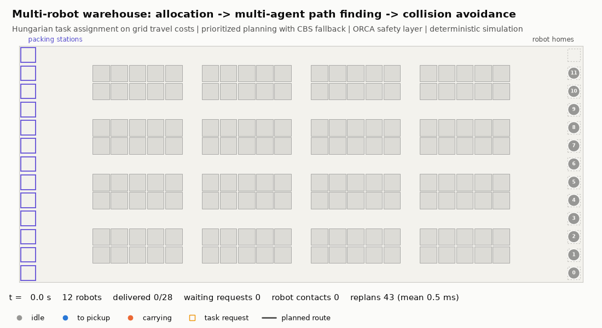

**A modern C++20 classical multi-robot systems library: consensus, formation and coverage control,
optimal and auction-based task allocation, multi-agent path finding, reciprocal collision avoidance,
cooperative exploration, distributed optimisation and a deterministic CPU simulator — with
reproducible animations, benchmarks and an optional ROS 2 adapter.**


-22314E?logo=ros)


Every animation in this README is rendered from the JSON output of a C++ demo
(`docs/assets/manifest.json` records scenario, seed, configuration, script and
commit). No machine learning, no GPU, no ROS required.

## Why MultiRobotCore

- **Classical and verified.** Graph theory, control, search and optimisation,
  each with its mathematical formulation, assumptions, limitations and
  references. Optimality claims are tested against independent exhaustive
  solvers (CBS, Hungarian) or closed forms (Laplacian spectra, quadrature).
- **One coherent stack.** Robot models → communication graphs → consensus →
  formation and coverage control → task allocation → MAPF → local avoidance →
  simulation → benchmarks, with strict separation of algorithms from the
  simulator and from middleware.
- **Honest about failure.** Independent planning collides, prioritized
  planning is incomplete, VO oscillates, distance-based formations converge
  only locally, consensus under message loss loses the average, a leader loss
  stalls a formation without re-election — all measured and shown.
- **Engineering.** C++20, CMake presets, exported targets for `find_package`,
  217 tests (unit, numerical, regression, integration), ASan/UBSan,
  clang-tidy, clang-format, warnings as errors on MSVC and GCC, a Jenkins
  pipeline, and a ROS 2 Jazzy adapter verified end to end.

## Gallery

| | |
|:---:|:---:|
| 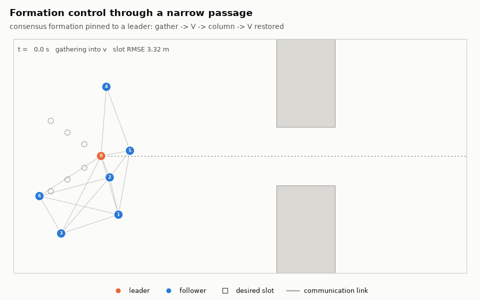 | 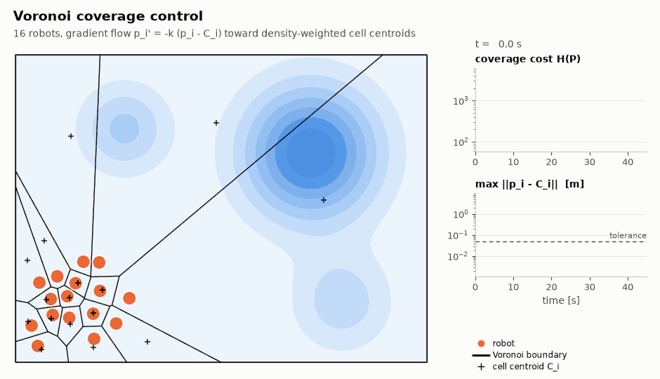 |
| **Formation through a passage** — gather, V, column, V restored | **Voronoi coverage** — Lloyd gradient flow on a non-uniform density |
| 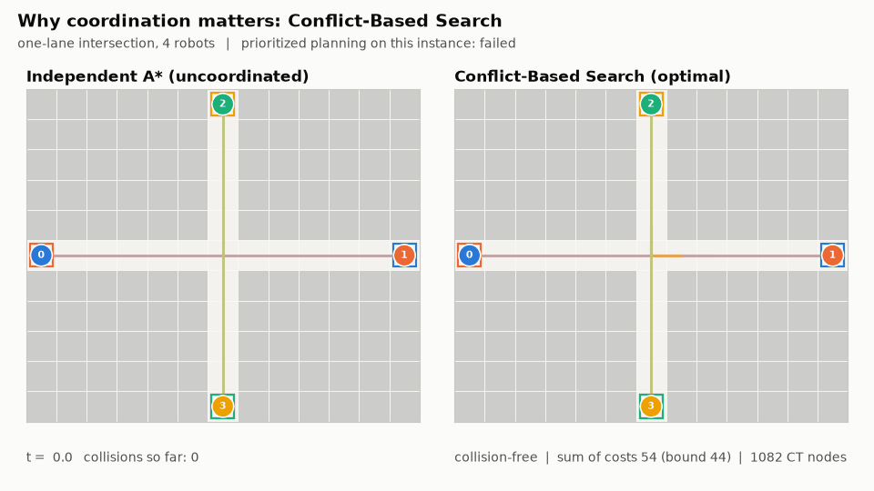 | 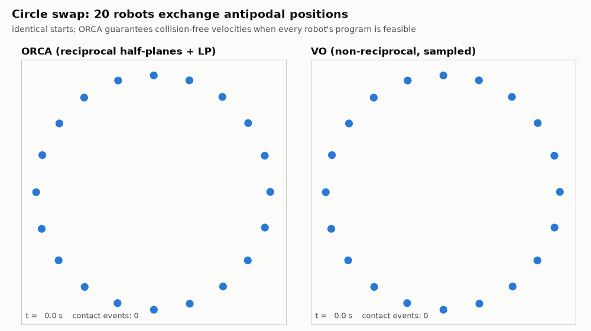 |
| **Conflict-Based Search** — independent paths collide, CBS resolves | **ORCA circle swap** — 20 robots, reciprocal avoidance |
| 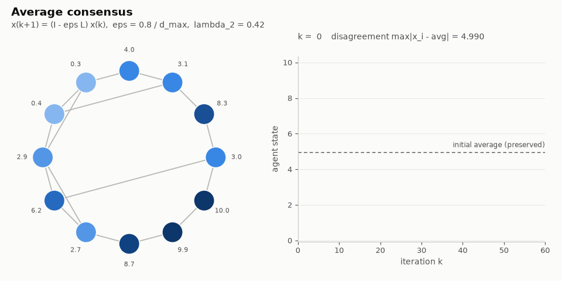 | 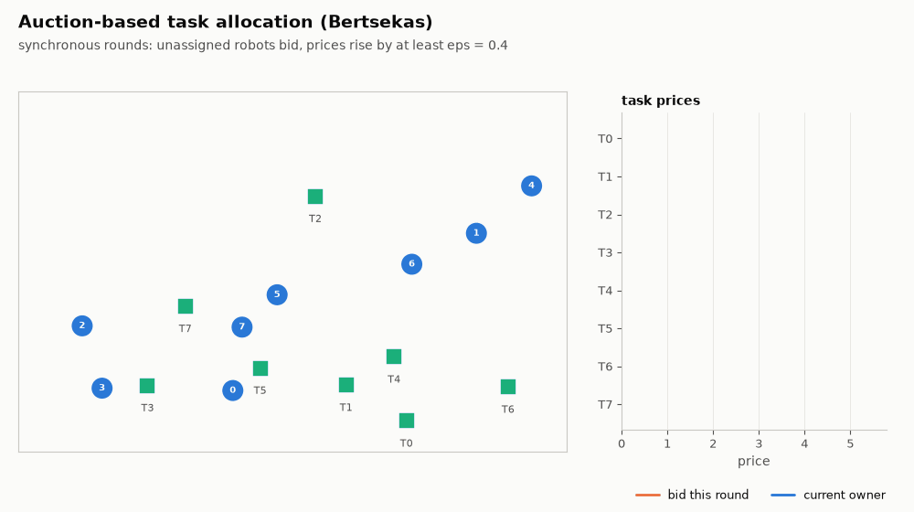 |
| **Average consensus** — spectral convergence on a sparse graph | **Auction allocation** — bids, rising prices, assignment |
| 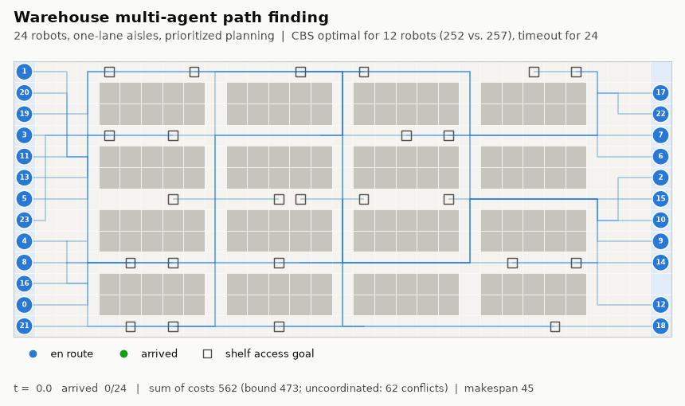 | 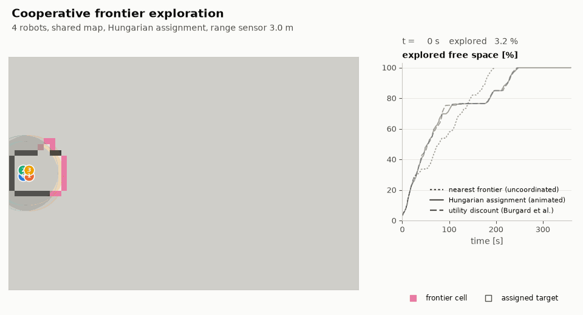 |
| **Warehouse MAPF** — 24 robots, prioritized planning | **Frontier exploration** — Hungarian frontier assignment |

More animations: [rendezvous](docs/assets/rendezvous.gif),
[consensus under link failure](docs/assets/consensus_partition.gif),
[leader loss and re-election](docs/assets/formation_leader_loss.gif),
[formation transitions](docs/assets/formation_transitions.gif),
[Hungarian assignment](docs/assets/hungarian.gif),
[dynamic allocation](docs/assets/allocation_dynamic.gif),
[velocity obstacles](docs/assets/velocity_obstacles.gif),
[doorway bottleneck](docs/assets/avoidance_bottleneck.gif),
[limited-range coverage](docs/assets/coverage_distributed.gif),
[distributed optimisation](docs/assets/distributed_optimization.gif).

## Architecture

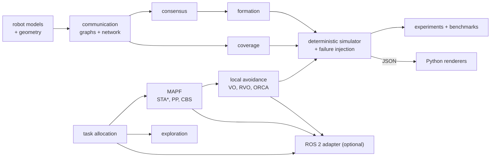

Each module is a CMake target (`MultiRobotCore::consensus`, `::mapf`, ...);
algorithms take and return plain values and never depend on the simulator.
Details: [architecture](docs/architecture/overview.md),
[simulation](docs/architecture/simulation.md),
[decisions](docs/adr/README.md).

## Quick start

```bash
cmake -S . -B build -DCMAKE_BUILD_TYPE=Release
cmake --build build --parallel
ctest --test-dir build

./build/apps/mrc_demo_warehouse                 # writes results/warehouse.json
scripts/setup/bootstrap_python.sh               # Python environment for the renderers
.venv/bin/python scripts/render/render_warehouse.py --build-dir build
```

```cmake
find_package(MultiRobotCore CONFIG REQUIRED)
target_link_libraries(my_app PRIVATE MultiRobotCore::mapf MultiRobotCore::allocation)
```

See [getting started](docs/tutorials/getting_started.md) and
[downstream usage](docs/tutorials/downstream_usage.md).

## Coordination: consensus, rendezvous, leader election

First- and second-order consensus (`X(k+1) = (I - eps L) X(k)`), weighted and
leader-follower (pinning) variants, rendezvous on proximity graphs with an
optional separation barrier for physical robots, message-passing consensus
over a lossy network with skip/stale policies, and min-identifier leader
election. Tests check average preservation, the spectral contraction bound
`max(|1 - eps lambda_2|, |1 - eps lambda_N|)`, the measured asymptotic rates,
and the oscillating `eps = 1/d_max` boundary on bipartite graphs.
→ [consensus](docs/algorithms/consensus.md), [graph foundations](docs/mathematics/graphs.md),
[benchmarks](docs/benchmarks/consensus.md)

## Formation control

Leader-follower, displacement-based consensus with pinning and gradient
distance-based control on minimally rigid (Henneberg) graphs; line, column,
triangle, square, circle, V and custom shapes; assignment-aware smooth
transitions. The integrated mission gathers dispersed robots into a V,
contracts to a column for a passage and restores the V, with the leader state
relayed through a lossy network; leader failure stalls the team unless
min-ID re-election is enabled.

| Controller | Formation | Formation RMSE | Convergence | Min distance |
|---|---|---|---|---|
| leader-follower | V | 0 m | 3.1 s (10/10 runs) | 0.12 m |
| consensus (pinned) | circle | 0.010 m | 19.1 s (10/10) | 0.014 m |
| distance-based | V | 0.33 m | 2/10 runs converge (local stability only) | 0.09 m |

→ [formation control](docs/algorithms/formation_control.md), [benchmarks](docs/benchmarks/formation.md)

## Task allocation

Hungarian (Kuhn–Munkres, rectangular and infeasible pairs), Bertsekas auction
(Gauss–Seidel and synchronous Jacobi bidding, `n eps` bound tested), dynamic
re-allocation with commitment and switching penalty, and sequential
single-item auctions for multi-task routes.

| Algorithm | Robots | Tasks | Cost gap vs. optimum | Messages |
|---|---|---|---|---|
| Hungarian | 100 | 100 | 0 % (optimal) | centralised |
| Auction (Jacobi) | 100 | 100 | ≤ 0.1 % of max cost (eps bound) | ≈ 2.5 M |
| Auction (Jacobi) | 100 | 200 | ≤ 0.1 % of max cost | ≈ 22 k |
| Greedy nearest pair | 100 | 100 | +23 % | — |

The auction is exact within its bound but pays in communication when robots
outnumber tasks (price wars). → [task allocation](docs/algorithms/task_allocation.md),
[benchmarks](docs/benchmarks/allocation.md)

## Multi-agent path finding

Grid maps (MovingAI format), space-time A* with vertex/edge constraints and a
goal test that respects later constraints, independent A* (unsafe baseline),
prioritized planning with ordering policies and restarts, and Conflict-Based
Search (sum-of-costs and makespan, cardinal-conflict prioritisation).
CBS optimality is verified against two independent joint-state reference
solvers on tiny instances.

| Planner | Map | Robots | Success | Sum of costs | Conflicts |
|---|---|---|---|---|---|
| Independent A* | open 32×32 | 40 | unsafe | 836.7 | 20 |
| Prioritized | open 32×32 | 40 | 3/3 | 837.3 | 0 |
| CBS | open 32×32 | 20 | 3/3 | 448.7 (optimal) | 0 |
| CBS | congestion | 16 | 3/3 | 97.3 (optimal) | 0 |
| CBS | warehouse | 15 | 3/3 | 297.3 | 0 |

CBS times out (3 s limit) in mazes and one-lane corridors where agents must
pass each other, and from about 20 robots in the warehouse — reported as
timeouts, not failures of the implementation. Success near the limit depends
on machine speed.
→ [space-time A*](docs/algorithms/space_time_astar.md),
[prioritized planning](docs/algorithms/prioritized_planning.md),
[CBS](docs/algorithms/conflict_based_search.md), [benchmarks](docs/benchmarks/mapf.md)

## Collision avoidance

Exact truncated velocity obstacles, sampling-based VO and RVO (van den Berg et
al. 2008 penalty) and ORCA with the reciprocal half-plane construction,
incremental 2-D linear program and the fallback that minimises the largest
violation. In the 20-robot circle swap ORCA and RVO record zero contacts while
VO records several; ORCA scales to 100 robots at well under a millisecond per
team update. Doorways and counterflow show congestion and stalls honestly.
→ [velocity obstacles](docs/algorithms/velocity_obstacles.md),
[ORCA](docs/algorithms/reciprocal_avoidance.md), [benchmarks](docs/benchmarks/avoidance.md)

## Coverage

Bounded Voronoi cells by bisector half-plane clipping, Gaussian-mixture
densities, deterministic quadrature (second-order convergence verified),
Lloyd iteration and the continuous gradient law `u_i = -k (p_i - C_i)`, plus a
limited-range variant where robots only clip against robots they can hear.
→ [Voronoi coverage](docs/algorithms/voronoi_coverage.md), [benchmarks](docs/benchmarks/coverage.md)

## Exploration

Occupancy grids, ray-cast range sensing, frontier detection and clustering,
and three strategies: nearest frontier, Hungarian frontier assignment and
Burgard-style utility discount. → [frontier exploration](docs/algorithms/frontier_exploration.md),
[benchmarks](docs/benchmarks/exploration.md)

## Distributed optimisation

Distributed gradient descent with Metropolis weights and decentralised
consensus ADMM on cooperative bearing-only target localisation (each robot's
cost is rank one). ADMM reaches the centralised optimum in tens to hundreds of
rounds; DGD converges sublinearly. → [distributed optimisation](docs/algorithms/distributed_optimization.md),
[benchmarks](docs/benchmarks/optimization.md)

## Integrated warehouse mission

Task requests → Hungarian allocation on grid travel costs → prioritized
planning with CBS fallback → timed waypoints and tracking → ORCA safety layer →
simulator. With 12 robots on a 31 × 13 m floor (seed 7): 28/28 requests
delivered, 43 re-plans with sub-millisecond planning, no planning failures and
no robot or shelf contacts. The [integration notes](docs/algorithms/warehouse_integration.md)
document when local avoidance invalidates the timing assumptions of a global
MAPF plan and which configurations caused contacts or blocking.

## Simulation

Deterministic CPU simulator: single/double integrator, unicycle and
differential-drive robots driven by desired velocities; static and appearing
obstacles; contact-event collision counting; clearance, travel and effort
metrics; stall detection; scheduled failures (robot stop/failure, leader loss,
link outages, new obstacles, task arrivals and cancellations) and a
message-level network simulator with latency, jitter, loss, range limits and
outages. → [simulation](docs/architecture/simulation.md), [communication](docs/algorithms/communication.md)

## ROS 2 (optional)

`ros2/multirobotcore_ros` wraps the warehouse coordinator, a generic ORCA
velocity safety filter and the simulator as ROS 2 Jazzy nodes; an end-to-end
`launch_testing` test delivers every task with zero contacts. The core never
depends on ROS. → [ROS 2 adapter](docs/architecture/ros2.md)

## Benchmarks

| Page | Contents |
|---|---|
| [consensus](docs/benchmarks/consensus.md) | iterations/messages vs. team size and topology; 0–20 % message loss |
| [formation](docs/benchmarks/formation.md) | controllers × shapes, moving leader, topology churn, mission under loss and noise |
| [allocation](docs/benchmarks/allocation.md) | Hungarian vs. auction vs. greedy, 5–200 robots, dynamic arrivals, SSI |
| [MAPF](docs/benchmarks/mapf.md) | open, maze, warehouse, corridor, congestion maps; success, cost, nodes |
| [avoidance](docs/benchmarks/avoidance.md) | VO / RVO / ORCA, 5–100 robots, circle swap, crossing, doorway |
| [coverage](docs/benchmarks/coverage.md) | Lloyd convergence 5–100 robots; limited communication range |
| [exploration](docs/benchmarks/exploration.md) | strategies × team sizes × maps |
| [optimisation](docs/benchmarks/optimization.md) | DGD vs. ADMM rounds and messages |

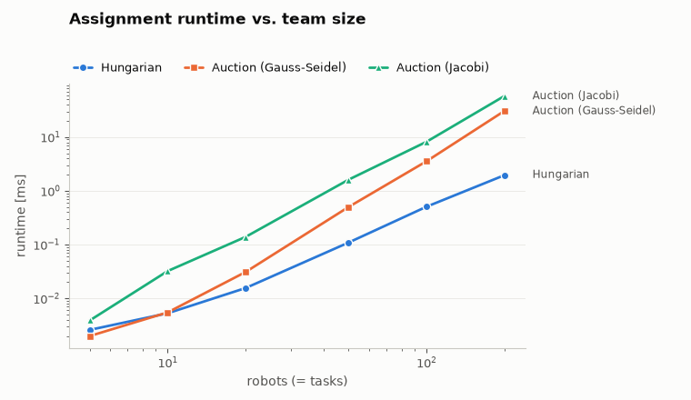

Runtimes are measured on a CPU-only laptop and are indicative; quality
metrics are deterministic. Regenerate with
`python scripts/benchmark/run_all.py --build-dir <build>`.

## Status

<!-- status:begin -->
| Area | Algorithm | Implemented | Tested | Demo | Benchmark |
|---|---|---|---|---|---|
| Graph foundations | [Graph Laplacians and connectivity](docs/mathematics/graphs.md) | ✅ | ✅ | — | ✅ |
| Communication | [Communication topologies and network impairments](docs/algorithms/communication.md) | ✅ | ✅ | ✅ | ✅ |
| Consensus | [Average consensus (discrete and continuous)](docs/algorithms/consensus.md) | ✅ | ✅ | ✅ | ✅ |
| Consensus | [Leader-follower and second-order consensus](docs/algorithms/consensus.md) | ✅ | ✅ | — | ✅ |
| Consensus | [Rendezvous](docs/algorithms/consensus.md) | ✅ | ✅ | ✅ | — |
| Consensus | [Message-passing consensus and leader election](docs/algorithms/consensus.md) | ✅ | ✅ | ✅ | ✅ |
| Formation control | [Leader-follower formation](docs/algorithms/formation_control.md) | ✅ | ✅ | ✅ | ✅ |
| Formation control | [Consensus (displacement-based) formation](docs/algorithms/formation_control.md) | ✅ | ✅ | ✅ | ✅ |
| Formation control | [Distance-based formation (rigid graphs)](docs/algorithms/formation_control.md) | ✅ | ✅ | — | ✅ |
| Formation control | [Formation transitions (assignment + smooth blending)](docs/algorithms/formation_control.md) | ✅ | ✅ | ✅ | — |
| Coverage | [Voronoi coverage (Lloyd / centroidal Voronoi)](docs/algorithms/voronoi_coverage.md) | ✅ | ✅ | ✅ | ✅ |
| Coverage | [Limited-range (distributed) coverage](docs/algorithms/voronoi_coverage.md) | ✅ | ✅ | ✅ | ✅ |
| Task allocation | [Hungarian assignment](docs/algorithms/task_allocation.md) | ✅ | ✅ | ✅ | ✅ |
| Task allocation | [Auction assignment (Gauss-Seidel / Jacobi)](docs/algorithms/task_allocation.md) | ✅ | ✅ | ✅ | ✅ |
| Task allocation | [Dynamic task re-allocation](docs/algorithms/task_allocation.md) | ✅ | ✅ | ✅ | ✅ |
| Task allocation | [Sequential single-item auctions (multi-task)](docs/algorithms/task_allocation.md) | ✅ | ✅ | — | ✅ |
| Multi-agent path finding | [Space-time A*](docs/algorithms/space_time_astar.md) | ✅ | ✅ | ✅ | ✅ |
| Multi-agent path finding | [Prioritized planning](docs/algorithms/prioritized_planning.md) | ✅ | ✅ | ✅ | ✅ |
| Multi-agent path finding | [Conflict-Based Search (cardinal conflicts)](docs/algorithms/conflict_based_search.md) | ✅ | ✅ | ✅ | ✅ |
| Collision avoidance | [Velocity obstacles (sampling-based VO)](docs/algorithms/velocity_obstacles.md) | ✅ | ✅ | ✅ | ✅ |
| Collision avoidance | [Reciprocal velocity obstacles (sampling-based RVO)](docs/algorithms/velocity_obstacles.md) | ✅ | ✅ | ✅ | ✅ |
| Collision avoidance | [ORCA (half-planes + incremental LP)](docs/algorithms/reciprocal_avoidance.md) | ✅ | ✅ | ✅ | ✅ |
| Collision avoidance | [Bottleneck / doorway avoidance study](docs/algorithms/reciprocal_avoidance.md) | ✅ | ✅ | ✅ | ✅ |
| Exploration | [Cooperative frontier exploration](docs/algorithms/frontier_exploration.md) | ✅ | ✅ | ✅ | ✅ |
| Distributed optimisation | [Distributed gradient descent](docs/algorithms/distributed_optimization.md) | ✅ | ✅ | ✅ | ✅ |
| Distributed optimisation | [Decentralised consensus ADMM](docs/algorithms/distributed_optimization.md) | ✅ | ✅ | ✅ | ✅ |
| Distributed optimisation | [Distributed MPC](docs/adr/0008-no-mpc-in-v0-1.md) | not implemented | — | — | — |
| Simulation | [Deterministic simulator and failure injection](docs/architecture/simulation.md) | ✅ | ✅ | ✅ | — |
| Integration | [Warehouse mission (allocation + MAPF + ORCA)](docs/algorithms/warehouse_integration.md) | ✅ | ✅ | ✅ | — |
| Integration | [Formation mission (passage, leader loss)](docs/algorithms/formation_control.md) | ✅ | ✅ | ✅ | ✅ |
| Integration | [ROS 2 adapter (coordinator, ORCA filter, simulator backend)](docs/architecture/ros2.md) | ✅ | ✅ | ✅ | — |
<!-- status:end -->

## Quality

| Check | Tooling |
|---|---|
| Tests | GoogleTest: unit, numerical, regression, integration (217 C++ tests) + pytest |
| Warnings | `/W4 /WX` (MSVC), `-Wall -Wextra -Wpedantic -Werror` and more (GCC, Clang) |
| Sanitizers | ASan + UBSan (clang-cl on Windows, clang++ on Linux) |
| Static analysis | clang-tidy (`.clang-tidy`) |
| Formatting | clang-format, Ruff |
| Packaging | `cmake --install` + downstream `find_package` consumer |
| CI | [Jenkinsfile](Jenkinsfile) (no hosted CI); renders and benchmarks opt-in |

## Documentation

[Architecture](docs/architecture/overview.md) ·
[Graph foundations](docs/mathematics/graphs.md) ·
[Algorithms](docs/algorithms) ·
[Benchmarks](docs/benchmarks) ·
[Tutorials](docs/tutorials/getting_started.md) ·
[Decisions](docs/adr/README.md) ·
[Status](docs/status.md) ·
[Project status](PROJECT_STATUS.md)

## Roadmap

- Distributed MPC with OSQP: centralised baseline and sequential distributed
  variant ([ADR 0008](docs/adr/0008-no-mpc-in-v0-1.md)).
- Forward/reverse auctions with epsilon scaling.
- Bounded-suboptimal and windowed MAPF (ECBS, rolling horizon) and
  symmetry-breaking constraints for corridors.
- ORCA polygon-edge obstacles and differential-drive ORCA.
- Nav2 / Gazebo adapters on top of the ROS 2 package.

## References

Key sources (each algorithm page lists its own): Olfati-Saber, Fax & Murray
(Proc. IEEE 2007); Ren & Beard (IEEE TAC 2005); Mesbahi & Egerstedt (2010);
Bullo, Cortés & Martínez (2009); Cortés, Martínez, Karataş & Bullo (IEEE TRA
2004); Kuhn (1955); Bertsekas (1988); Sharon, Stern, Felner & Sturtevant (AIJ
2015); Silver (2005); Fiorini & Shiller (IJRR 1998); van den Berg, Lin &
Manocha (ICRA 2008); van den Berg, Guy, Lin & Manocha (ISRR 2009);
Yamauchi (1998); Burgard et al. (IEEE T-RO 2005); Nedić & Ozdaglar (IEEE TAC
2009); Shi et al. (IEEE TSP 2014); LaValle, *Planning Algorithms* (2006).

This is an engineering implementation of established methods; it does not
claim new algorithms.

## License

[MIT](LICENSE)
