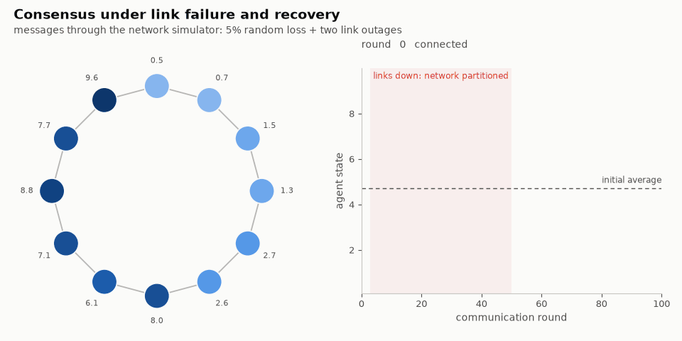

# Communication graphs and network impairments

Module: `MultiRobotCore::communication` — headers `communication/topology.hpp`,
`communication/network.hpp`; failure injection in `simulation/events.hpp`.

## Purpose

Distributed algorithms are only as good as their information flow. This
module builds position-dependent communication graphs and simulates message
exchange with latency, loss, range limits and outages, so that robustness can
be measured rather than assumed. It is deliberately not a radio or packet
simulator.

## Topology models

| Model | Graph |
|---|---|
| Fixed | user-provided graph |
| Disk | undirected edge `{i, j}` iff `||p_i - p_j|| <= R` |
| k-nearest | `j -> i` for the `k` nearest `j` of `i` (ties by index); optional symmetrisation |
| Dropout | each edge removed independently with probability `p` (seeded) |
| Line of sight | edges whose segment intersects an obstacle are removed |
| Failures | inactive robots are isolated |

## Message-level network simulator

`NetworkSimulator` carries messages `(sender, receiver, topic, payload)`.
Each send is checked in order against node outages, link outages
(bidirectional, half-open intervals `[start, end)`), the range limit and an
independent loss draw; surviving messages are delivered after a fixed latency
plus uniform jitter, ordered by `(delivery time, send sequence)`. A message
whose receiver is down at delivery time is dropped. The random stream is
consumed for every send attempt, so deterministic failures do not shift the
random sequence. Statistics: messages sent/delivered, drops by cause, bytes
(header + 8 bytes per payload value) and communication rounds.

## Failure injection

`simulation::EventSchedule` releases timed events in `(time, insertion)`
order; `apply_event` applies robot stop, robot failure, leader loss, recovery,
link failure (with duration) and appearing obstacles to the simulator and the
network. Task arrival and cancellation events are returned to the scenario,
which owns the task model.

## Assumptions and limitations

- Losses are independent per message; there is no channel contention, fading
  or bandwidth limit.
- Range limits are binary.
- Time is the continuous simulation time; a "round" is an application-level
  synchronous exchange counted with `mark_round()`.

## Validation

`tests/unit/communication`: disk and kNN construction, dropout reproducibility
and bounds, line-of-sight filtering, isolation of inactive robots, latency
ordering, empirical loss rate, reproducibility from the seed, outage and range
accounting, drops at delivery time. `tests/unit/simulation`: event ordering
and effects on simulator and network.

## References

- F. Bullo, J. Cortés, S. Martínez, *Distributed Control of Robotic Networks*,
  Princeton University Press, 2009 (proximity graphs, robotic network models).
- M. Mesbahi, M. Egerstedt, *Graph Theoretic Methods in Multiagent Networks*,
  Princeton University Press, 2010.
