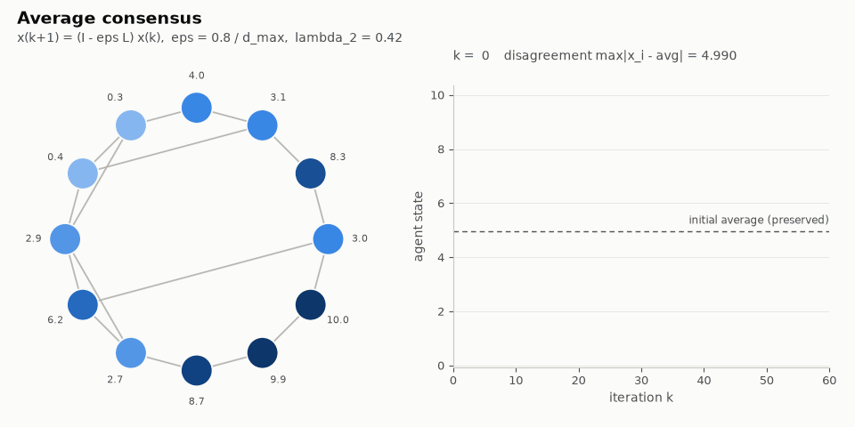

# Consensus, rendezvous and leader election

Module: `MultiRobotCore::consensus` — headers `consensus/consensus.hpp`,
`consensus/distributed.hpp`.



## Purpose

Consensus protocols let robots agree on a quantity (a heading, a meeting
point, an estimate) using only neighbour information. They are the basic
building block of formation control, rendezvous, distributed estimation and
distributed optimisation.

## Problem formulation

Each robot `i` holds a state `x_i in R^d` (states are stored row-wise in an
`N x d` matrix `X`). Robots communicate over a graph with adjacency `A`
(convention in [graph foundations](../mathematics/graphs.md)). The goal is
`x_i - x_j -> 0` for all pairs, using only `x_j` from in-neighbours.

## Mathematics

| Protocol | Dynamics | Converges to |
|---|---|---|
| Continuous first order | `x_i' = sum_j a_ij (x_j - x_i)`, i.e. `X' = -L X` | average (undirected/balanced), weighted average of root states (spanning tree) |
| Discrete first order | `X(k+1) = (I - eps L) X(k) = P X(k)` | as above for `0 < eps < 1/d_max` |
| Leader-follower (pinning) | `x_i <- x_i + eps [sum_j a_ij (x_j - x_i) + b_i (r - x_i)]` | reference `r` if every robot is reachable from the pinned set |
| Second order (Ren 2008) | `p_i'' = sum_j a_ij [(p_j - p_i) + gamma (v_j - v_i)]` | common velocity (average for undirected graphs) |
| Rendezvous | `u_i = k sum_j a_ij (p_j - p_i)` on a proximity graph | a common point while the graph stays connected |

**Convergence rate (undirected, connected).** The disagreement vector
`delta = X - 1 avg(X)` contracts by at least
`rho = max(|1 - eps lambda_2|, |1 - eps lambda_N|) < 1` per discrete step
(`discrete_contraction_factor`), and like `exp(-lambda_2 t)` in continuous
time. The average is invariant because `1^T L = 0`.

**Step-size boundary.** With `eps = 1 / d_max` the Perron matrix is still
row stochastic, but on bipartite regular graphs (even rings) `lambda_N = 2 d_max`
gives an eigenvalue `-1` and the alternating mode never decays. The strict
inequality `eps < 1/d_max` is required; a regression test reproduces the
oscillation.

## Assumptions

- Fixed graphs for the convergence statements above; switching graphs
  converge when the union graph over bounded intervals is jointly connected
  (Jadbabaie, Lin & Morse 2003; Ren & Beard 2005) — the library simulates such
  cases but does not prove them for a given run.
- Rendezvous with a disk graph assumes the graph remains connected; linear
  consensus does not preserve connectivity in general.
- Point rendezvous is a mathematical abstraction: physical robots collide.
  `rendezvous_with_separation_velocities` adds a short-range barrier on top of
  the saturated consensus cohesion; its equilibria are compact clusters, not a
  single point, and it carries no convergence guarantee.

## Message-passing implementation

`DistributedConsensus` exchanges states through `communication::NetworkSimulator`
in synchronous rounds. A lost message is either **skipped** for that round or
replaced by the **last received** (stale) value. Losses make the effective graph
time-varying and unbalanced, so the average is no longer preserved exactly — the
[link-failure demo](../assets/consensus_partition.gif) shows the resulting bias.

`elect_leader_min_id` implements minimum-identifier flooding (Lynch 1996):
after `diameter` lossless rounds every connected component of operational
robots agrees on its smallest identifier. It is used for leader re-election in
the formation mission.

## Implementation notes

- `-L X` is applied through neighbour lists (`O(|E| d)`), never by forming `L`.
- `run_consensus` records the disagreement `max_i ||x_i - avg||` per step and
  stops at a tolerance or an iteration cap.
- All randomness (network loss, initial values in demos) uses explicitly
  seeded `std::mt19937_64` generators.

## Complexity

One synchronous step costs `O(|E| d)` time and `2|E|` messages. Iterations to a
relative tolerance scale like `1 / (eps lambda_2)`: constant for complete
graphs, `O(N^2)` for rings and paths.

## Configuration

`configs/consensus/consensus.json` (demo) and `configs/consensus/benchmark.json`
(experiments): team sizes, topologies, step fraction `eps d_max`, drop rates.

## Example

```cpp
#include <multirobotcore/consensus/consensus.hpp>
#include <multirobotcore/graph/topologies.hpp>

namespace mrc = multirobotcore;
const auto g = mrc::graph::ring_graph(8);
mrc::consensus::StateMatrix x0 = mrc::consensus::StateMatrix::Random(8, 2);
const double eps = 0.9 * mrc::consensus::max_convex_step(g);   // strictly below 1/d_max
const auto run = mrc::consensus::run_consensus(g, x0, {eps, 5000, 1e-9, false});
// run.final_state rows equal the initial average up to 1e-9
```

## Validation

`tests/unit/consensus`: average preservation at every step, spectral
contraction bound on random graphs, disconnected components agreeing
separately, directed chains following their root, absence of agreement without
a spanning tree, convex-hull invariance, the exponential bound in continuous
time, pinning, second-order agreement, equivalence of the message-passing and
centralised iterations without loss, convergence under 20% loss, leader
election after a failure and under partitions.

## Benchmark

See [consensus benchmarks](../benchmarks/consensus.md): iterations, messages
and runtime versus team size for five topologies, and rounds/bias under
0–20% message loss.

## Known limitations

- No guarantees are claimed for the stale-value policy under unbounded delays.
- Rendezvous with separation is a heuristic for physical robots.
- Leader election assumes reliable rounds for its agreement guarantee; with
  losses more rounds are needed and agreement is checked, not assumed.

## References

- R. Olfati-Saber, J. A. Fax, R. M. Murray, "Consensus and cooperation in
  networked multi-agent systems," *Proceedings of the IEEE*, 95(1):215–233, 2007.
- R. Olfati-Saber, R. M. Murray, "Consensus problems in networks of agents with
  switching topology and time-delays," *IEEE TAC*, 49(9):1520–1533, 2004.
- W. Ren, R. W. Beard, "Consensus seeking in multiagent systems under
  dynamically changing interaction topologies," *IEEE TAC*, 50(5):655–661, 2005.
- W. Ren, "On consensus algorithms for double-integrator dynamics," *IEEE TAC*,
  53(6):1503–1509, 2008.
- A. Jadbabaie, J. Lin, A. S. Morse, "Coordination of groups of mobile
  autonomous agents using nearest neighbor rules," *IEEE TAC*, 48(6):988–1001, 2003.
- F. Bullo, J. Cortés, S. Martínez, *Distributed Control of Robotic Networks*,
  Princeton University Press, 2009.
- R. Olfati-Saber, "Flocking for multi-agent dynamic systems: algorithms and
  theory," *IEEE TAC*, 51(3):401–420, 2006.
- N. A. Lynch, *Distributed Algorithms*, Morgan Kaufmann, 1996.
