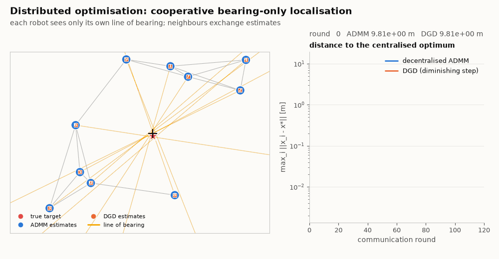

# Distributed optimisation

Module: `MultiRobotCore::optimization` — header `optimization/distributed.hpp`.

## Purpose

Solve a team-wide optimisation problem when each robot only knows its own
part of the objective and talks to its neighbours: cooperative estimation,
agreement on a meeting point, distributed parameter fitting.

## Problem formulation

    minimise  F(x) = sum_i f_i(x),   f_i(x) = 1/2 ||A_i x - b_i||^2

Robot `i` knows only `(A_i, b_i)` and communicates over a connected
undirected graph. The worked example is **cooperative bearing-only target
localisation**: robot `i` at `p_i` measures the bearing `beta_i` to an unknown
target `theta`; the line-of-bearing constraint `n_i^T (theta - p_i) = 0` with
`n_i = (-sin beta_i, cos beta_i)` gives a *rank-one* local cost, so no robot
can localise the target alone, but the sum is strongly convex as soon as two
bearings are not parallel.

## Algorithms

**Distributed (sub)gradient descent** (Nedić & Ozdaglar 2009):

    x_i <- sum_j W_ij x_j - alpha_k grad f_i(x_i)

with Metropolis–Hastings weights `W` (symmetric, doubly stochastic). A
constant step converges only to a neighbourhood of the optimum (the fixed
point is not exact); `alpha_k = alpha / sqrt(k + 1)` converges, slowly.

**Decentralised consensus ADMM** (Shi, Ling, Yuan, Wu & Yin 2014):

    x_i^{k+1} = argmin f_i(x) + x^T a_i^k + rho sum_{j in N_i} ||x - (x_i^k + x_j^k)/2||^2
    a_i^{k+1} = a_i^k + rho sum_{j in N_i} (x_i^{k+1} - x_j^{k+1})

For least squares the primal step is the linear solve
`(A_i^T A_i + 2 rho d_i I) x = A_i^T b_i - a_i + rho sum_j (x_i + x_j)`; each
robot factorises its constant matrix once (LDLT).

The centralised reference solves the normal equations with an LDLT
factorisation (no explicit inverse) and rejects singular geometries.

## Metrics

Per iteration: objective gap `F(mean x) - F*`, consensus error
`max_i ||x_i - mean x||`, solution error `max_i ||x_i - x*||`; communication
rounds (one per iteration) and messages (`2 |E|` per round).

## Assumptions

Connected undirected graph (checked), synchronous rounds, lossless exchange.

## Validation

Noise-free bearings give the target exactly; parallel bearings are rejected
as singular; ADMM converges to the centralised solution; DGD with a
diminishing step approaches it; DGD with a constant step stalls at an error
floor that shrinks with the step; invalid inputs are rejected.

## Benchmark

[Optimisation benchmarks](../benchmarks/optimization.md): rounds to
`1e-4 (1 + ||x*||)`, final error, messages and runtime versus team size for a
ring and a random geometric graph. ADMM needs tens to a few hundred rounds;
DGD does not reach the tolerance within 20,000 rounds.

## Known limitations

- Only quadratic local costs are implemented; general convex costs would need
  an inner solver for the ADMM primal step.
- No asynchronous or lossy variants yet (the network simulator could provide
  them).

## References

- A. Nedić, A. Ozdaglar, "Distributed subgradient methods for multi-agent
  optimization," *IEEE Transactions on Automatic Control*, 54(1):48–61, 2009.
- S. Boyd, N. Parikh, E. Chu, B. Peleato, J. Eckstein, "Distributed
  optimization and statistical learning via the alternating direction method
  of multipliers," *Foundations and Trends in Machine Learning*, 3(1):1–122, 2011.
- W. Shi, Q. Ling, K. Yuan, G. Wu, W. Yin, "On the linear convergence of the
  ADMM in decentralized consensus optimization," *IEEE Transactions on Signal
  Processing*, 62(7):1750–1761, 2014.
- L. Xiao, S. Boyd, S. Lall, "A scheme for robust distributed sensor fusion
  based on average consensus," *Proc. IPSN*, 2005.
