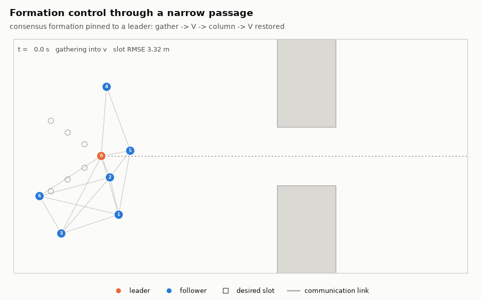
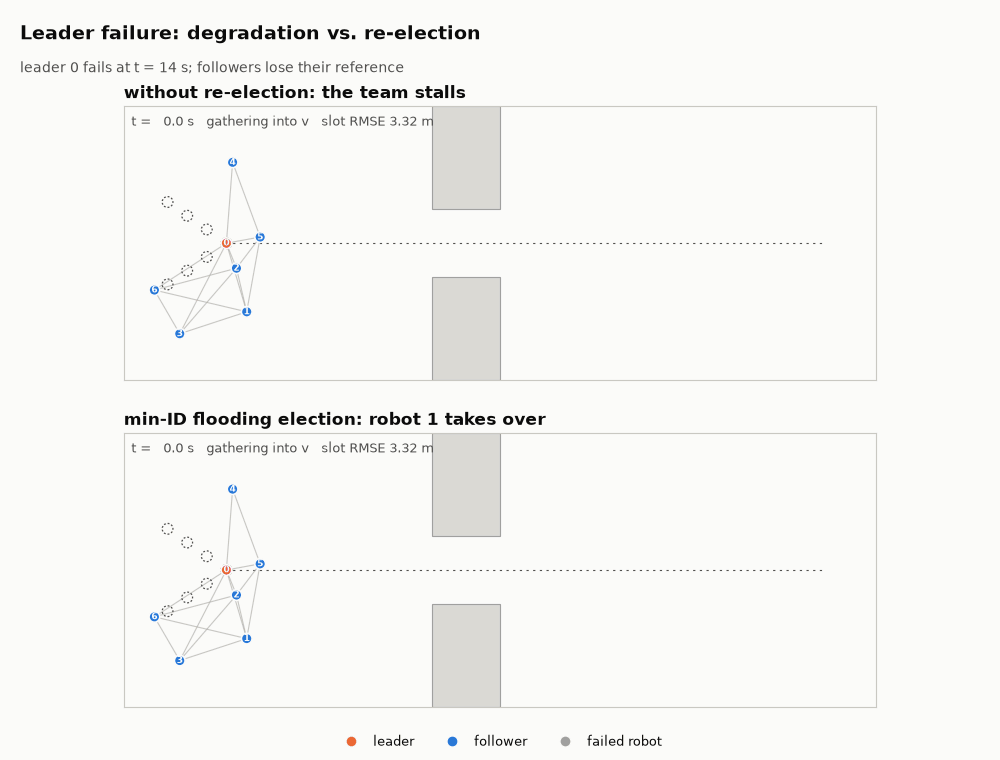

# Formation control

Module: `MultiRobotCore::formation` — headers `formation/shapes.hpp`,
`formation/controllers.hpp`, `formation/metrics.hpp`, `formation/transition.hpp`,
`formation/safety.hpp`; integrated scenario `scenarios/formation_mission.hpp`.



## Purpose

Keep a team in a prescribed geometric arrangement while it moves, reconfigure
the arrangement smoothly (e.g. contract to pass a narrow passage), and degrade
predictably when communication or the leader fails.

## Problem formulation

Desired geometry is a list of offsets `d_i` in a formation frame whose `+x`
axis points along the direction of travel. A reference pose `(p_r, theta_r)`
maps them to world slots `p_i* = p_r + R(theta_r) d_i`. Robots are single
integrators `p_i' = u_i` with a speed limit. The task is
`p_i - p_i* -> 0` (absolute placement) or `(p_j - p_i) - R (d_j - d_i) -> 0`
(shape up to translation), using neighbour information on a graph.

Shapes (`make_shape`): line (abreast), column, triangle, square block, circle
(regular polygon with neighbour spacing `s`), V (configurable half-angle) and
custom offsets. Shapes are centred; `relative_to_slot` re-expresses them
relative to a leader slot.

## Mathematics

| Controller | Law | Guarantee (no saturation) |
|---|---|---|
| Leader-follower | `u_i = v_L + k (p_L + R(theta_L) d_i - p_i)` | exponential convergence to the slots; without feedforward a steady lag `|v_L| / k` |
| Displacement consensus | `u_i = v_r + k sum_j a_ij [(p_j - p_i) - R (d_j - d_i)] + k_p b_i (p_r + R d_i - p_i)` | shape up to translation on connected undirected graphs; exact slots if every robot is reachable from a pinned one |
| Distance-based (Krick, Broucke & Francis 2009) | `u_i = k sum_{j in N_i} (||p_i - p_j||^2 - d_ij^2)(p_j - p_i)` | **local** asymptotic stability for infinitesimally rigid frameworks |

For leader-follower and displacement consensus the error `e = p - p*` obeys
`e' = -(L + B) e` (with `B = diag(b_i)`), independent of the shape — hence
identical convergence times for different shapes in the benchmark.

**Rigidity.** Distance constraints fix a shape only for rigid frameworks.
`henneberg_graph` builds a minimally rigid graph (`2N - 3` edges) by Henneberg
type-I additions, growing the framework greedily and choosing two anchors that
are *not collinear* with the new vertex. The tests check the rigidity-matrix
rank `2N - 3`; an earlier nearest-two-anchors construction produced collinear
anchor pairs on lattice shapes and failed this test. Collinear shapes (line,
column) are inherently flexible.

**Transitions.** Robots are assigned to target slots by minimising the sum of
squared distances (Hungarian method); for synchronised straight-line motion
this is the assignment of CAPT (Turpin, Michael & Kumar 2014), collision free
when start and goal locations are more than `2 sqrt(2)` radii apart. Offsets
are blended with a quintic smoothstep, so slot velocity and acceleration are
continuous; `offset_rates_at` provides the velocity feedforward.

## Integrated mission (passage reconfiguration)

`run_formation_mission`: robots spawn at random, gather into a V around a
leader (robot 0), follow a path, contract into a column `contract_distance`
before a passage, restore the V once every robot has cleared it, and continue.

- *Information flow.* The leader state propagates through
  `communication::NetworkSimulator` by multi-hop relay (range-limited, optionally
  lossy and delayed); followers extrapolate the freshest state for at most
  `extrapolation_horizon`. Relay was necessary: with direct broadcast only, a
  robot spawned just outside radio range never received the reference.
- *Safety.* The saturated tracking command is combined with barrier-like
  separation and obstacle repulsion (`formation/safety.hpp`) that exceed the
  speed limit near contact; failed robots are treated as obstacles.
- *Leader failure.* Without re-election the followers keep a stale reference
  and the mission stalls; with min-identifier flooding the lowest operational
  robot becomes leader and the shape is re-expressed relative to its slot.



## Assumptions

Single-integrator kinematics with a speed limit; planar world; relative
positions are sensed (optionally noisy), the leader state is communicated.

## Implementation notes

- All laws return velocity commands and accept per-robot references, so they
  can be fed with estimates received over a lossy network.
- `formation_error` measures slot RMSE with three alignments: reference pose,
  best translation, or best rigid motion (2-D Procrustes).

## Complexity

`O(|E|)` per control step for consensus and distance laws; `O(N^3)` for the
transition assignment, executed once per transition.

## Configuration

`configs/formation/formation.json` (demo), `configs/formation/benchmark.json`
(experiments).

## Example

```cpp
#include <multirobotcore/formation/controllers.hpp>
#include <multirobotcore/formation/shapes.hpp>
namespace f = multirobotcore::formation;
const auto offsets = f::relative_to_slot(f::make_shape(f::Shape::kV, 7, 1.4), 0);
const auto u = f::leader_follower_velocities(leader_pose, leader_velocity, 0, positions, offsets,
                                             {1.2, 1.0, true});
```

## Validation

Unit tests (`tests/unit/formation`): spacing and centring of all shapes,
rigidity rank, alignment modes, convergence of every law, feedforward lag
`v/k`, optimal slot assignment against brute force, smooth transitions with a
pinned leader. Integration tests (`tests/integration/test_formation_mission.cpp`):
passage traversal without contacts, stall after leader loss, recovery by
re-election, graceful degradation under 20% message loss.

## Benchmark

[Formation benchmarks](../benchmarks/formation.md): RMSE, convergence and
minimum distance for three controllers × three shapes; moving leader; per-step
edge dropout; the mission under 0–80% loss and position noise.

## Known limitations

- The distance law only converges locally; from ±1.5 m perturbations it often
  converges to a wrong (e.g. reflected) shape.
- The separation and obstacle terms are heuristics without formal safety
  guarantees; minimum clearances are measured and reported, not certified.
- The relay floods the leader state; communication volume grows with the
  number of links (reported in the benchmark).

## References

- J. P. Desai, J. P. Ostrowski, V. Kumar, "Modeling and control of formations of
  nonholonomic mobile robots," *IEEE Transactions on Robotics and Automation*,
  17(6):905–908, 2001.
- K.-K. Oh, M.-C. Park, H.-S. Ahn, "A survey of multi-agent formation control,"
  *Automatica*, 53:424–440, 2015.
- L. Krick, M. E. Broucke, B. A. Francis, "Stabilisation of infinitesimally
  rigid formations of multi-robot networks," *International Journal of
  Control*, 82(3):423–439, 2009.
- W. Ren, R. W. Beard, *Distributed Consensus in Multi-vehicle Cooperative
  Control*, Springer, 2008.
- M. Turpin, N. Michael, V. Kumar, "CAPT: Concurrent assignment and planning of
  trajectories for multiple robots," *International Journal of Robotics
  Research*, 33(1):98–112, 2014.
- T. Balch, R. C. Arkin, "Behavior-based formation control for multirobot
  teams," *IEEE Transactions on Robotics and Automation*, 14(6):926–939, 1998.
