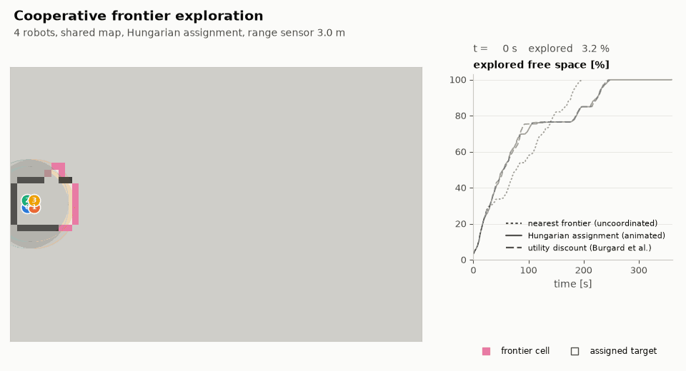

# Cooperative frontier exploration



## Purpose

Map an unknown environment with several robots as quickly as possible, by
repeatedly sending robots to the boundary between known free space and unknown
space (frontiers), and coordinating which robot goes where.

## Problem formulation

A ground-truth occupancy grid is unknown to the robots. Robots share one belief
grid with states unknown / free / occupied, sense with a range sensor, and
move one grid cell per step. The goal is to make all free space reachable from
the starts known, minimising exploration time; secondary measures are travelled
distance, redundant observation and communication.

## Mathematics

* Frontier cell: a known-free cell with an unknown 4-neighbour (Yamauchi 1997).
* Frontier clusters: 8-connected components of frontier cells; each is
  represented by its member closest to the cluster centroid (a reachable cell
  even when the centroid itself is not).
* Travel cost `d(i, t)`: 4-connected BFS distance over known-free cells.
* Information gain `I(t)`: number of unknown cells within sensor range of `t`
  (an optimistic estimate that ignores occlusion).
* Assignment strategies:
  * nearest frontier (Yamauchi 1998): each robot independently takes its
    closest reachable target;
  * Hungarian: minimise `sum_i lambda d(i, t_i) - w_I I(t_i)` over one-to-one
    assignments (`allocation::solve_hungarian`); unreachable pairs are
    infeasible, robots left over when frontiers are scarce take their nearest
    target;
  * utility discount (Burgard, Moors, Stachniss & Schneider 2005): greedily pick
    the robot-target pair maximising `U_t - beta V_it` (normalised gain and
    normalised cost), then reduce every target's utility by
    `P(d) = max(0, 1 - d / r)` with `d` the distance to the chosen target.

## Assumptions

* Shared, centralised map (a map server); every robot uploads newly observed
  cells each step and receives a target after each re-planning.
* Perfect localisation and a noise-free sensor: the benchmark isolates the
  effect of target coordination.
* Robots are points on the grid; inter-robot collisions are not modelled in
  this module (the MAPF and avoidance modules address collision-free motion).

## Algorithm

Each step:

1. Re-plan if the period elapsed, a robot is idle, or its target stopped being
   a frontier: detect frontiers, cluster them (ignoring clusters below
   `min_cluster_size` unless none remain), assign targets, BFS paths.
2. Move every robot one cell along its path.
3. Ray-cast each robot's sensor against the ground truth and copy the observed
   cells into the belief.
4. Stop when all reachable free space is known or no frontier is reachable.

## Implementation notes

* `exploration::simulate_scan` traverses every beam with the grid traversal of
  Amanatides & Woo (1987); beams stop at the first occupied cell. Beam angles
  are offset by half an angular step so that no beam runs exactly along a grid
  diagonal, where the traversal tie-break would depend on the last bits of
  `cos`/`sin` and could differ between math libraries.
* Coverage is measured on ground-truth free cells reachable from the starts.
* Redundancy: cells observed by two or more different robots over the run.
* Communication model: `messages` counts map uploads (one per robot and step
  with new cells, 5 bytes per cell) and target broadcasts after re-planning.
* One step lasts `resolution / speed` seconds (1 s in the demo and benchmark).

## Complexity

Frontier detection and clustering are `O(cells)` per re-planning; BFS
distances are `O(N cells)` for `N` robots; the Hungarian step is
`O(N^2 K)` for `K` clusters; the utility-discount step is `O(N^2 K)`. Each scan
is `O(beams * range / resolution)`. All benchmark runs (up to 8 robots, 2400
cells) take well under 0.2 s.

## Configuration

`configs/exploration/exploration.json` (demo) and
`configs/exploration/benchmark.json`.

| Key | Meaning |
|---|---|
| `map`, `resolution` | ASCII scenario (`#` occupied, `.` free) and cell size [m] |
| `starts` | start cells |
| `strategy` | `nearest_frontier`, `hungarian` or `utility_discount` |
| `sensor.range`, `sensor.beams` | range [m] and beam count |
| `planner.information_weight`, `planner.cost_weight` | `w_I` and `lambda` / `beta` |
| `planner.discount_radius` | `r` [m] for the utility discount |
| `planner.min_cluster_size` | smallest frontier cluster considered |
| `replan_period`, `max_steps` | re-planning period and step limit |

## Example

```cpp
#include <multirobotcore/exploration/exploration.hpp>

namespace ex = multirobotcore::exploration;
const auto truth = ex::OccupancyGrid::load_ascii("scenarios/exploration/office.txt", 0.5);
ex::ExplorationConfig config;
config.planner.strategy = ex::Strategy::kHungarian;
config.sensor = {3.0, 180};
ex::ExplorationSimulation sim(truth, {{2, 19}, {3, 19}, {2, 20}, {3, 20}}, config);
const ex::ExplorationResult result = sim.run();
```

Run the demo and render: `mrc_demo_exploration` then
`python scripts/render/render_exploration.py`.

## Benchmark

See [docs/benchmarks/exploration.md](../benchmarks/exploration.md): three maps,
1-8 robots, three strategies, three seeds, all runs complete. With one robot
the nearest-frontier rule is fastest everywhere; with eight robots the
Hungarian assignment completes the office in 122 s versus 161 s and the rooms
map in 58 s versus 93 s for the uncoordinated rule. In the animated office run
(four robots starting together) the uncoordinated rule is faster (197 s versus
360 s): coordination is not uniformly beneficial for small teams.

## Known limitations

* Centralised shared map; no map merging, limited-range communication or
  rendezvous for map exchange.
* Noise-free sensing and perfect localisation (no SLAM).
* The information-gain estimate ignores occlusion.
* The end of a run is dominated by small leftover pockets; strategies are not
  tuned to avoid this cleanup phase.
* Robots may share cells (no collision model in this module).

## References

* B. Yamauchi. A frontier-based approach for autonomous exploration.
  Proceedings of the IEEE International Symposium on Computational
  Intelligence in Robotics and Automation (CIRA), pp. 146-151, 1997.
* B. Yamauchi. Frontier-based exploration using multiple robots. Proceedings of
  the Second International Conference on Autonomous Agents, pp. 47-53, 1998.
* W. Burgard, M. Moors, C. Stachniss, F. Schneider. Coordinated multi-robot
  exploration. IEEE Transactions on Robotics, 21(3):376-386, 2005.
* J. Amanatides, A. Woo. A fast voxel traversal algorithm for ray tracing.
  Eurographics '87, pp. 3-10, 1987.
* H. W. Kuhn. The Hungarian method for the assignment problem. Naval Research
  Logistics Quarterly, 2(1-2):83-97, 1955.
