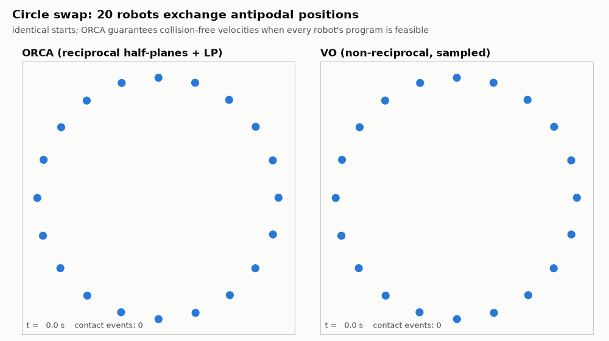
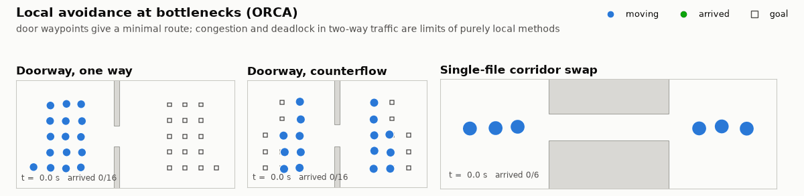

# Optimal reciprocal collision avoidance (ORCA)

Headers: [`orca.hpp`](../../include/multirobotcore/avoidance/orca.hpp),
[`linear_program.hpp`](../../include/multirobotcore/avoidance/linear_program.hpp),
[`avoidance.hpp`](../../include/multirobotcore/avoidance/avoidance.hpp),
[`simulation_adapter.hpp`](../../include/multirobotcore/avoidance/simulation_adapter.hpp) ·
Tests: [`tests/unit/avoidance`](../../tests/unit/avoidance),
[`tests/regression/avoidance`](../../tests/regression/avoidance) ·
Demos: [`avoidance_circle_swap.cpp`](../../apps/demos/avoidance_circle_swap.cpp),
[`avoidance_bottleneck.cpp`](../../apps/demos/avoidance_bottleneck.cpp) ·
Benchmark: [`avoidance_benchmark.cpp`](../../apps/benchmarks/avoidance_benchmark.cpp),
[report](../benchmarks/avoidance.md)



## Purpose

Each robot independently computes a velocity close to its preferred velocity
such that, if every neighbour does the same, no pair collides within the time
horizon `tau`. Only positions and velocities of neighbours are needed; there is
no communication. This implementation follows van den Berg, Guy, Lin and
Manocha, "Reciprocal n-body collision avoidance" (2011); it is named ORCA
because it implements that formulation: the `u`/`n` half-plane construction,
half responsibility for reciprocating robots, the incremental 2D linear program
with the circular speed constraint, and the 3D program for infeasible cases.

## Problem formulation

For robot A and each neighbour B (notation of [velocity_obstacles.md](velocity_obstacles.md)):

```
u = (argmin_{w on boundary of VO^tau} ||w - (v_A - v_B)||) - (v_A - v_B)
n = outward normal of VO^tau at (v_A - v_B) + u
ORCA^tau_{A|B} = { v : (v - (v_A + rho u)) . n >= 0 }
```

with responsibility `rho = 1/2` for reciprocating robots and `rho = 1` for
static or non-reciprocating obstacles. The new velocity solves

```
minimise ||v - v_pref||   subject to  v in ORCA_{A|B} for every neighbour B,  ||v|| <= v_max .
```

## Mathematics

* **Collision-freedom.** If `v_A' in ORCA_{A|B}` and `v_B' in ORCA_{B|A}`
  (which uses `-u` and `-n`), adding the two inequalities gives
  `((v_A' - v_B') - (v + u)) . n >= 0`: the new relative velocity lies in the
  half-plane that supports the convex set `VO^tau` at its boundary point
  `v + u`, so it is outside `VO^tau` and the pair is collision-free for `tau`.
  The unit test `ReciprocalChoicesAreCollisionFreeForTheHorizon` checks this
  property on random pairs.
* **Closest boundary point.** With `w = v - p / tau` (from the cut-off centre):
  if `w . p < 0` and `(w . p)^2 > R^2 ||w||^2`, the closest point lies on the
  cut-off arc: `n = w / ||w||`, `u = (R / tau - ||w||) n`. Otherwise it lies on
  the leg selected by the sign of `cross(p, w)`, with `u = (v . d) d - v` for the
  unit leg direction `d` and `n` the outward leg normal.
* **Overlapping robots.** If `||p|| <= R`, the construction uses the time step
  `dt` instead of `tau`, which requests separation within one step.
* **Linear program.** Incremental 2D LP (de Berg et al. 2008, ch. 4; Seidel
  1991) with the speed disc: if the current optimum violates constraint `i`, the
  new optimum lies on line `i` and is found by a 1D program on that line,
  bounded by the disc and the previous constraints.
* **Infeasible case.** Minimise the largest violation of the robot constraints
  subject to the hard obstacle constraints and the speed disc. Solved
  incrementally: when constraint `i` is violated by more than the current
  maximum, keep the region where every previous violation is at most that of
  `i` (half-planes `(n_j - n_i) . v >= c_j - c_i`) and maximise `n_i . v` with
  the 2D LP. The unit tests compare both programs with brute-force sampling.

## Assumptions

Holonomic robots with instantaneous velocity changes, exact sensing of
neighbour positions and velocities, all neighbours running ORCA with the same
`tau`, and mutual neighbourhoods. Static obstacles are discs: circles are used
directly, and each axis-aligned box is covered by the boundary cells of a grid
with spacing `obstacle_disc_spacing`, one circumscribed disc per cell
(conservative by at most half a cell diagonal). Polygonal obstacle lines as in
the ORCA paper's obstacle section are **not** implemented.

## Algorithm

`CollisionAvoider::compute()` for every active robot:

1. Collect up to `max_neighbors` robots within `neighbor_distance` (closest
   first, ties by index), all inactive robots in range (static, `rho = 1`),
   and all obstacle discs in range.
2. Build obstacle constraints first (hard, horizon `obstacle_time_horizon`),
   then robot constraints (soft, horizon `time_horizon`). Radii are inflated by
   `safety_margin`.
3. Solve the 2D LP; if infeasible, run the 3D fallback.

## Implementation notes

* Deterministic: no randomness inside the library; neighbour order and LP
  processing order are fixed.
* `diagnose()` returns, for one robot, every VO cone, RVO cone, ORCA
  half-plane and the selected velocity (used for the velocity-space animation).
* `simulation_adapter.hpp` connects the avoider with
  `simulation::Simulator` (header-only, so the avoidance library itself depends
  only on the core module).
* `last_infeasible_count()` reports how many robots needed the fallback.

## Complexity

Per robot: `O(N)` neighbour search (brute force) plus an LP over `m`
constraints, expected `O(m)` for random order and worst case `O(m^2)` for the
fixed order used here; the fallback is `O(m^2)`–`O(m^3)` in the worst case.
Measured with `benchmarks/bench_avoidance.cpp` (Release, single thread):

| Robots | 10 | 50 | 100 | 200 |
|---|---:|---:|---:|---:|
| Team update | 0.014 ms | 0.11 ms | 0.20 ms | 0.42 ms |

One LP with 16 random constraints takes about 0.3 µs.

## Configuration

```json
"avoidance": {
  "time_horizon": 5.0, "obstacle_time_horizon": 1.5,
  "neighbor_distance": 10.0, "max_neighbors": 20,
  "safety_margin": 0.02, "obstacle_disc_spacing": 0.15
}
```

Defaults: `tau = 3 s`, obstacle `tau = 1.5 s`, 5 m sensing radius, 16
neighbours, 2 cm safety margin, 50 ms step.

## Example

```cpp
#include <multirobotcore/avoidance/simulation_adapter.hpp>
namespace av = multirobotcore::avoidance;

const av::CollisionAvoider avoider(av::AvoidanceConfig{}, sim.obstacles());
std::vector<Vec2> preferred(sim.num_robots());
for (std::size_t i = 0; i < sim.num_robots(); ++i) {
  preferred[i] = av::preferred_velocity(sim.robot(i).position, goals[i], 1.0);
}
sim.step(av::safe_velocities(avoider, sim, preferred));
```

## Benchmark

Circle swap of 20 robots (radius 0.3 m, 1 m/s, `configs/avoidance/circle_swap.json`):

| Method | Reached | Contact events | Min clearance [m] | Makespan [s] | Path efficiency |
|---|---:|---:|---:|---:|---:|
| ORCA | 20/20 | 0 | 0.040 | 25.3 | 0.97 |
| RVO (sampled) | 20/20 | 0 | 0.042 | 22.5 | 0.95 |
| VO (sampled) | 20/20 | 3 | -0.052 | 25.8 | 0.88 |

Bottlenecks (ORCA, 16 robots of radius 0.25 m, `configs/avoidance/bottleneck.json`):

| Scenario | Reached | Contacts | Outcome |
|---|---:|---:|---|
| Doorway, one way (door waypoints) | 16/16 | 0 | completed in 22.7 s |
| Doorway, counterflow | 5/16 | 0 | congestion at the door after 60 s |
| Single-file corridor swap (3 + 3) | 4/6 | 0 | stall detected at 59.2 s |

The full sweep over 5 to 100 robots is in [docs/benchmarks/avoidance.md](../benchmarks/avoidance.md).



## Known limitations

* **Guarantees hold only for feasible programs.** In dense crowds the LP is
  infeasible and the fallback minimises the largest violation, so small
  overlaps can occur. Non-mutual neighbourhoods (the `max_neighbors` cap)
  have the same effect. The default 2 cm safety margin absorbs the overlaps
  observed in the benchmarks.
* **Symmetric equilibria / deadlock.** On an exactly collinear head-on
  approach the constraint is parallel to the line of centres, so no lateral
  motion arises. In a perfectly symmetric circle swap the robots freeze in a
  ring where neighbours touch: with 20 robots and only 0.001 m/s of preference
  noise the run did not finish within 70 s, while 0.05 m/s of noise resolved
  it in 25 s (same seed and parameters). The
  unit test `ExactlySymmetricHeadOnSwapIsAnOrcaEquilibrium` documents the
  equilibrium.
* **No global reasoning.** Counterflow through a door and single-file corridor
  swaps congest or deadlock (stall heuristic, not a formal proof). Preferred
  velocities pointing through walls create local minima; the doorway demo needs
  waypoints for that reason.
* **Interaction with global MAPF plans.** Local avoidance changes speeds and
  paths, so robots drift from the timing of a space-time multi-agent plan:
  vertex/edge reservations computed by prioritised planning or CBS assume
  robots are at specific cells at specific timesteps. Combining the two needs
  either execution-time synchronisation (wait for predecessors before entering
  a cell) or replanning; local avoidance alone can invalidate the conflict-free
  guarantee of the global plan and can deadlock where the plan would not.
* Holonomic model only; non-holonomic extensions (e.g. Alonso-Mora et al.) and
  acceleration constraints are not implemented.

## References

* J. van den Berg, S. J. Guy, M. Lin and D. Manocha, "Reciprocal n-body
  collision avoidance," in *Robotics Research: The 14th International
  Symposium ISRR*, Springer Tracts in Advanced Robotics, vol. 70, pp. 3–19, 2011.
* J. van den Berg, M. Lin and D. Manocha, "Reciprocal velocity obstacles for
  real-time multi-agent navigation," *Proc. IEEE ICRA*, pp. 1928–1935, 2008.
* P. Fiorini and Z. Shiller, "Motion planning in dynamic environments using
  velocity obstacles," *The International Journal of Robotics Research*,
  17(7):760–772, 1998.
* M. de Berg, O. Cheong, M. van Kreveld and M. Overmars, *Computational
  Geometry: Algorithms and Applications*, 3rd ed., Springer, 2008 (chapter 4).
* R. Seidel, "Small-dimensional linear programming and convex hulls made easy,"
  *Discrete & Computational Geometry*, 6:423–434, 1991.
* J. Alonso-Mora, A. Breitenmoser, M. Rufli, P. Beardsley and R. Siegwart,
  "Optimal reciprocal collision avoidance for multiple non-holonomic robots,"
  *Distributed Autonomous Robotic Systems*, Springer Tracts in Advanced
  Robotics, vol. 83, pp. 203–216, 2013 (related work, not implemented).
