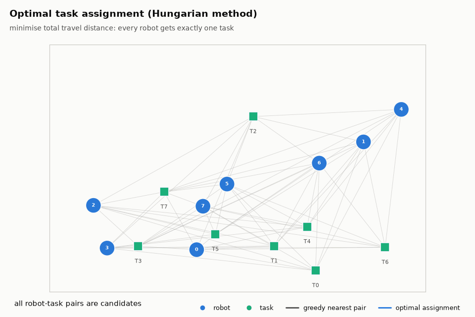
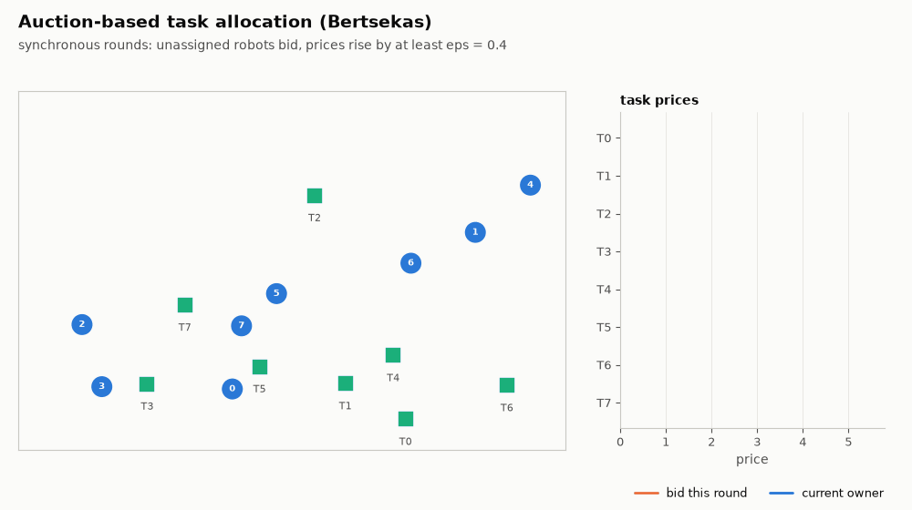

# Task allocation

Module: `MultiRobotCore::allocation` — headers `allocation/types.hpp`,
`allocation/hungarian.hpp`, `allocation/auction.hpp`, `allocation/dynamic.hpp`,
`allocation/sequential_auction.hpp`.



## Purpose

Decide which robot serves which task: once (instantaneous assignment), as
tasks arrive (dynamic re-allocation) or with several tasks per robot (routes).

## Problem formulation

Single-task robots, single-robot tasks, instantaneous assignment (ST-SR-IA,
Gerkey & Matarić 2004): given an `n x m` cost matrix `C` (robots × tasks,
`+inf` = infeasible pair) find an injective robot→task map `sigma` minimising
`sum_i C(i, sigma(i))`. For rectangular problems `min(n, m)` pairs are
assigned. Infeasible pairs are handled lexicographically: first maximise the
number of feasible pairs, then minimise cost.

Cost models: Euclidean route length (pickup and optional drop-off),
travel time (`distance / speed + service time`), energy
(`energy_per_meter * distance`), weighted combinations with capacity
constraints (`demand > capacity` → infeasible) and arbitrary callables. The
warehouse mission uses true grid (BFS) travel distances.

## Mathematics and algorithms

**Hungarian / Kuhn–Munkres** (Kuhn 1955; Munkres 1957) in the
`O(n^2 m)` shortest-augmenting-path form with dual potentials (cf. Jonker &
Volgenant 1987). Rectangular problems are solved directly (transposing when
`n > m`). Infeasible entries are replaced by a penalty
`M = 2 k max|c| + 1` (`k = min(n, m)`) that exceeds any difference between the
feasible parts of two assignments, which yields the lexicographic objective.

**Auction** (Bertsekas 1988, 1992). Robots bid for tasks with benefits
`b_ij = M - c_ij`; an unassigned robot bids `p_j* + (v1 - v2) + eps` for its
best task. The final assignment satisfies eps-complementary slackness and is
within `n eps` of the optimum; for integer costs `eps < 1/n` is optimal.
Every robot owns a private "stay unassigned" object of benefit 0, so
rectangular and infeasible cases solve the same lexicographic problem as the
Hungarian method. Bidding is Gauss–Seidel (one robot at a time) or Jacobi
(all unassigned robots per synchronous round — the distributed form).
Messages follow a shared-price-board model: one per bid, one broadcast per
price change.

*Why no epsilon scaling.* The formulation is asymmetric (more objects than
bidders). The `n eps` bound then also requires every object that ends
unassigned to have zero price. A single forward-auction phase guarantees it
(an object that received a bid stays assigned), but scaling phases that
restart from non-zero prices do not — an early implementation with scaling
missed the bound by large margins on random instances. Forward/reverse
auctions (Bertsekas & Castañón 1992) are the standard remedy and are left as
future work.

**Dynamic re-allocation.** `DynamicTaskAllocator` re-solves an assignment with
inertia whenever tasks arrive, complete or are cancelled: robots within
`commit_distance` of their task keep it, and moving a robot to a different task
costs `switching_penalty`, which suppresses thrashing for marginal gains.

**Multiple tasks per robot.** Sequential single-item auctions (Koenig et al.
2006): one task per round is awarded to the globally lowest bid, where each
robot bids its marginal cost of inserting the task into its current route
(MiniSum) or the resulting route length (MiniMax), subject to a per-robot
capacity. SSI is a heuristic, not an exact vehicle-routing solver.



## Assumptions

Costs are known to the solver (centralised Hungarian/SSI) or to each bidder
(auction). Costs are static during one solve.

## Implementation notes

- `Assignment` carries both maps (robot→task, task→robot) and the total cost;
  `is_consistent()` checks injectivity.
- `solve_auction_traced` records every Jacobi round (bids, owners, prices) for
  visualisation.

## Complexity

| Method | Time | Communication |
|---|---|---|
| Hungarian | `O(n^2 m)` | centralised |
| Auction | pseudo-polynomial, `O(n m C / eps)` worst case | bids + price broadcasts |
| Dynamic re-allocation | one Hungarian/auction per event | — |
| SSI | `O(|T|^2 |R| L)` with route length `L` | one bid per robot and round |

## Configuration

`configs/allocation/allocation.json` (demo), `configs/allocation/benchmark.json`
(experiments).

## Example

```cpp
#include <multirobotcore/allocation/hungarian.hpp>
namespace al = multirobotcore::allocation;
const al::CostMatrix costs = al::euclidean_costs(robots, tasks);
const al::Assignment best = al::solve_hungarian(costs);
const al::AuctionResult auction = al::solve_auction(costs, {al::BiddingMode::kJacobi, 0.01});
```

## Validation

Hungarian matches exhaustive search on 400 random rectangular instances with
infeasible pairs. The auction meets the `n eps` bound on 200 random
rectangular/infeasible instances in both bidding modes and is exactly optimal
for integer costs with `eps < 1/n`. Dynamic tests cover arrivals, hysteresis,
commitment and cancellation; SSI tests cover capacity, route-length
consistency and MiniMax balancing.

## Benchmark

[Allocation benchmarks](../benchmarks/allocation.md): cost gap, runtime and
messages for Hungarian, both auctions and greedy across team sizes and
shapes; dynamic arrivals with different switching penalties; SSI objectives.
Headline: the auction matches the optimum within its bound but needs many
rounds and messages when robots outnumber tasks (price wars), while the
centralised Hungarian method stays in the millisecond range.

## Known limitations

- No epsilon scaling or reverse auctions (see above).
- SSI is a heuristic; capacity is a task count, not a payload model.
- Dynamic allocation re-plans on events, not continuously.

## References

- H. W. Kuhn, "The Hungarian method for the assignment problem," *Naval
  Research Logistics Quarterly*, 2(1–2):83–97, 1955.
- J. Munkres, "Algorithms for the assignment and transportation problems,"
  *Journal of the SIAM*, 5(1):32–38, 1957.
- R. Jonker, A. Volgenant, "A shortest augmenting path algorithm for dense and
  sparse linear assignment problems," *Computing*, 38:325–340, 1987.
- D. P. Bertsekas, "The auction algorithm: A distributed relaxation method for
  the assignment problem," *Annals of Operations Research*, 14:105–123, 1988.
- D. P. Bertsekas, "Auction algorithms for network flow problems: A tutorial
  introduction," *Computational Optimization and Applications*, 1:7–66, 1992.
- D. P. Bertsekas, D. A. Castañón, "A forward/reverse auction algorithm for
  asymmetric assignment problems," *Computational Optimization and
  Applications*, 1(3):277–297, 1992.
- B. P. Gerkey, M. J. Matarić, "A formal analysis and taxonomy of task
  allocation in multi-robot systems," *International Journal of Robotics
  Research*, 23(9):939–954, 2004.
- S. Koenig, C. Tovey, M. Lagoudakis, V. Markakis, D. Kempe, P. Keskinocak,
  A. Kleywegt, A. Meyerson, S. Jain, "The power of sequential single-item
  auctions for agent coordination," *Proc. AAAI*, 2006.
