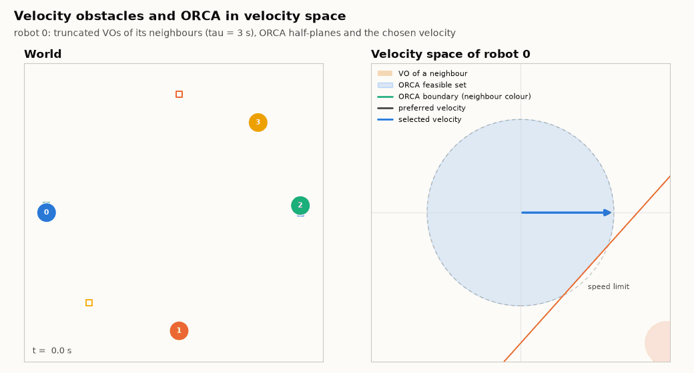

# Velocity obstacles (VO) and reciprocal velocity obstacles (RVO)

Headers: [`velocity_obstacle.hpp`](../../include/multirobotcore/avoidance/velocity_obstacle.hpp),
[`sampling.hpp`](../../include/multirobotcore/avoidance/sampling.hpp),
[`avoidance.hpp`](../../include/multirobotcore/avoidance/avoidance.hpp) ·
Tests: [`tests/unit/avoidance`](../../tests/unit/avoidance) ·
Demo: [`avoidance_velocity_space.cpp`](../../apps/demos/avoidance_velocity_space.cpp) ·
Animation: [`velocity_obstacles.gif`](../assets/velocity_obstacles.gif)



## Purpose

Local collision avoidance between moving disc-shaped robots: given each robot's
*preferred* velocity (from a global planner or a go-to-goal law), choose a
nearby velocity that does not lead to a collision within a time horizon. The
velocity obstacle is the geometric object behind VO, RVO and ORCA (see
[reciprocal_avoidance.md](reciprocal_avoidance.md)).

## Problem formulation

Robot A at position `p_A` with velocity `v_A` and radius `r_A`; neighbour B with
`p_B`, `v_B`, `r_B`. Let `p = p_B - p_A`, `R = r_A + r_B` and the relative
velocity `v = v_A - v_B`. A and B collide within the horizon `tau` if

```
exists t in [0, tau] :  || p - t v || < R .
```

The set of relative velocities with this property is the truncated velocity
obstacle `VO^tau(p, R)`. In A's absolute velocity space the obstacle is
`v_B + VO^tau` (Fiorini & Shiller 1998).

## Mathematics

* `VO^tau = union_{t in (0, tau]} D(p / t, R / t)`: a cone with apex at the
  origin, legs tangent to the disc `D(p / tau, R / tau)` and cut off by that
  disc. It is **convex**: it is the set `{s x : x in D(p, R), s >= 1/tau}`.
* Leg directions: `p` rotated by `+/- asin(R / ||p||)`; e.g. the
  counter-clockwise leg is `(p_x l - p_y R, p_x R + p_y l) / ||p||^2` with
  `l = sqrt(||p||^2 - R^2)`.
* Membership is decided exactly through the closest approach within the
  horizon, `d(v) = min_{t in [0, tau]} ||p - t v||` (`t* = clamp(p.v / v.v, 0, tau)`):
  inside if `d < R`, boundary if `d = R` (within a tolerance), outside otherwise.
* Time to collision: the smallest root of `(v.v) t^2 - 2 (p.v) t + ||p||^2 - R^2 = 0`;
  zero if the discs overlap, infinity if they separate.
* **RVO** (van den Berg, Lin & Manocha 2008): if both robots take half of the
  avoidance effort, A's new velocity `v'` is unsafe iff `2 v' - v_A` lies in
  `VO_{A|B}(v_B)`. Equivalently `RVO = (v_A + v_B)/2 + (1/2) VO^tau`, which is
  the cone with apex `(v_A + v_B)/2` and horizon `2 tau` (scaling a truncated VO by
  1/2 doubles its horizon).

## Assumptions

Holonomic disc robots that can change velocity instantly (single integrator);
neighbours' positions and velocities are observed exactly; static obstacles
are discs (boxes are covered by discs, see the ORCA page). VO assumes that the
neighbour keeps its velocity; RVO assumes that the neighbour applies the same
rule.

## Algorithm

Sampling-based selection, deterministic:

1. Candidates: the preferred velocity (clipped to the speed limit), zero, and a
   polar grid of `speed_rings x angle_samples` velocities aligned with the
   preferred direction (so the sample set rotates with the scenario).
2. For each candidate, the earliest predicted collision time `t_c` over all
   neighbours within the sensing radius: relative velocity `v - v_B` (VO) or
   `2 v - v_A - v_B` (RVO); static obstacles always use the VO form.
   Collisions later than the horizon are ignored; for already-overlapping discs,
   separating velocities count as collision-free.
3. Choose the candidate with the smallest penalty `w / t_c + ||v_pref - v||`
   (the penalty of the RVO paper); ties keep the earlier candidate.

## Implementation notes

* `classify_relative_velocity` and `VelocityObstacleCone` expose the exact
  geometry (apex, cut-off disc, legs) that the renderer draws; Python never
  recomputes it.
* Inactive robots (stopped or failed) are passed as static obstacles with zero
  velocity.
* Candidate generation, neighbour ordering and tie-breaking are deterministic.

## Complexity

`O(K M)` per robot for `K = 2 + rings x directions` candidates and `M`
neighbours/obstacle discs, plus the brute-force neighbour search `O(N)` per
robot. Measured (Release, single thread, 12-core laptop CPU):

| Team update (all robots) | 10 robots | 50 robots | 100 robots |
|---|---:|---:|---:|
| sampled RVO, 6 x 36 candidates | 0.13 ms | 1.6 ms | 4.7 ms |
| ORCA (for comparison) | 0.014 ms | 0.11 ms | 0.20 ms |

## Configuration

`AvoidanceConfig` (`configs/avoidance/*.json`, key `avoidance`):
`time_horizon`, `obstacle_time_horizon`, `neighbor_distance`, `max_neighbors`,
`safety_margin`, `speed_rings`, `angle_samples`, `penalty_weight`.

## Example

```cpp
#include <multirobotcore/avoidance/avoidance.hpp>
namespace av = multirobotcore::avoidance;

av::AvoidanceConfig config;
config.method = av::AvoidanceMethod::kReciprocalVelocityObstacle;
const av::CollisionAvoider avoider(config, obstacles);
const std::vector<Vec2> safe = avoider.compute(agents, preferred, max_speeds);
```

## Benchmark

From [docs/benchmarks/avoidance.md](../benchmarks/avoidance.md) (circle swap,
robots of radius 0.25 m, 1 m/s, seed 11):

| Method | 20 robots: contact events | 50 robots: contact events | 50 robots: path efficiency |
|---|---:|---:|---:|
| VO (sampled) | 8 | 40 | 0.74 |
| RVO (sampled) | 0 | 0 | 0.86 |
| ORCA | 0 | 0 | 0.92 |

## Known limitations

* **VO oscillates.** Both robots of a pair avoid the full obstacle, over-react,
  then return to their preferred velocity: the "reciprocal dance" that
  motivated RVO. In dense scenes this produces contacts (table above).
* **RVO is not collision-free either**: sampling picks the best candidate even
  when every candidate is inside some RVO; three or more robots break the
  pairwise reciprocity argument; residual oscillations remain (cf. the hybrid
  RVO of Snape et al. 2011, not implemented).
* Sampling resolution limits optimality; cost grows with the number of
  samples.
* Symmetric configurations can be equilibria; the demos add a small seeded
  perturbation to preferred velocities.
* No dynamics: robots are assumed to track any velocity within one step. For
  unicycle robots, use the simulator's look-ahead tracking (not a certified
  non-holonomic extension).

## References

* P. Fiorini and Z. Shiller, "Motion planning in dynamic environments using
  velocity obstacles," *The International Journal of Robotics Research*,
  17(7):760–772, 1998.
* J. van den Berg, M. Lin and D. Manocha, "Reciprocal velocity obstacles for
  real-time multi-agent navigation," *Proc. IEEE International Conference on
  Robotics and Automation (ICRA)*, pp. 1928–1935, 2008.
* J. Snape, J. van den Berg, S. J. Guy and D. Manocha, "The hybrid reciprocal
  velocity obstacle," *IEEE Transactions on Robotics*, 27(4):696–706, 2011
  (related work, not implemented).
