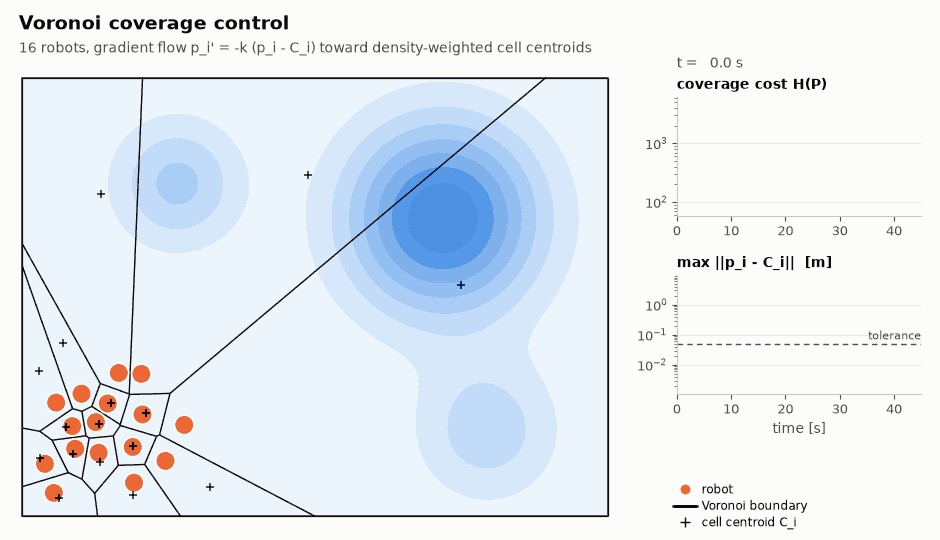

# Voronoi coverage control



## Purpose

Deploy a team of robots over a bounded region so that every point is close to
some robot, with more robots where a density (importance) function is high:
sensor networks, surveillance, environmental sampling, service robots that
must reach requests quickly.

## Problem formulation

Robots at positions `P = (p_1, ..., p_N)` in a convex polygon `Q`, density
`phi : Q -> [0, inf)`. The locational cost is

```
H(P) = sum_i  integral over V_i(P) of ||q - p_i||^2 phi(q) dq
```

where `V_i(P) = { q in Q : ||q - p_i|| <= ||q - p_j|| for all j }` is the
Voronoi cell of robot `i`. Minimising `H` places each robot at the
density-weighted centroid of its own cell.

## Mathematics

With cell mass `M_i = int_{V_i} phi` and centroid
`C_i = (1 / M_i) int_{V_i} q phi(q) dq`, the gradient of the cost is
(Cortes, Martinez, Karatas & Bullo 2004)

```
dH / dp_i = 2 M_i (p_i - C_i)
```

Critical points are centroidal Voronoi configurations `p_i = C_i` (Du, Faber &
Gunzburger 1999). Two update laws are implemented:

* gradient flow `p_i' = -k (p_i - C_i)`, saturated to the robot speed and
  executed in the simulator;
* Lloyd's iteration `p_i <- C_i` (Lloyd 1982), which never increases `H`.

**Limited range** (Cortes, Martinez & Bullo 2005). With communication radius
`R`, robot `i` uses its r-limited cell `V_i ∩ B(p_i, R/2)`. Every bisector that
can intersect `B(p_i, R/2)` belongs to a robot within distance `R`, so the
r-limited cell is computed exactly from in-range neighbours; it equals the
Voronoi cell whenever the cell lies inside `B(p_i, R/2)`, which each robot can
check locally. The resulting controller descends the limited-range cost
rather than `H`.

## Assumptions

* Convex polygonal domain, static density, holonomic (single-integrator)
  robots for the analysis; the simulator also runs other dynamics through the
  same velocity interface.
* Perfect position knowledge of neighbours (centralised variant: of all
  robots).
* Robots are points for the partition; physical separation is reported, not
  enforced (Voronoi configurations keep robots apart in practice).

## Algorithm

1. For every robot, clip the domain with the bisector half-planes of the other
   robots in order of increasing distance; stop once the next robot is farther
   than twice the largest vertex distance of the current cell (no farther
   bisector can cut it).
2. Integrate mass, first moment and cost over each cell.
3. Move each robot toward its centroid (gradient flow) or onto it (Lloyd).

## Implementation notes

* `coverage::voronoi_cell` / `bounded_voronoi`: exact convex half-plane
  clipping (`math::ConvexPolygon::clipped`), no general Voronoi construction.
  Voronoi neighbours are the robots whose bisector contributes a cell edge.
* Coincident robots: the lowest index owns the shared region, the others get an
  empty cell and zero velocity until the owner moves away (tested).
* `coverage::integrate_cell`: fan triangulation, each triangle split into `s^2`
  sub-triangles, symmetric 3-point rule exact for quadratics. Uniform
  densities are therefore integrated exactly; Gaussian mixtures converge with
  `s` (relative mass error below `1e-5` at `s = 16` in the tests).
* `coverage::clip_to_disc`: the disc `B(p, R/2)` is represented by its
  inscribed regular 32-gon (area error 0.64 %).
* Settling time in the demo: the time after which the largest centroid
  distance stays below the tolerance until the end of the run (with a 2 s
  confirmation window).

## Complexity

One partition sorts the other `N - 1` robots for every cell
(`O(N^2 log N)`) and clips with the few nearest (typically 5-8 half-planes per
cell); quadrature is `O(N s^2)`. Measured time per Lloyd iteration: 0.03 ms
(5 robots) to 2.5 ms (100 robots), see the benchmark. A spatial index would
remove the quadratic sorting term for much larger teams.

## Configuration

`configs/coverage/coverage.json` (demo) and `configs/coverage/benchmark.json`.

| Key | Meaning |
|---|---|
| `domain` | convex polygon vertices [m] |
| `density.floor`, `density.bumps` | constant floor and Gaussian bumps (`mean`, `sigma`, `weight`) |
| `controller.gain`, `controller.max_speed` | `k` [1/s] and speed limit [m/s] |
| `controller.subdivisions` | quadrature level `s` |
| `distributed.communication_radius` | `R` [m] for the limited-range run |
| `convergence_tolerance` | centroid-distance tolerance [m] |

## Example

```cpp
#include <multirobotcore/coverage/coverage_control.hpp>

namespace cov = multirobotcore::coverage;
const auto domain = multirobotcore::math::ConvexPolygon::from_box({{0, 0}, {12, 9}});
const auto density = cov::DensityFunction::gaussian_mixture({{{8.6, 6.1}, 1.35, 6.0}}, 0.15);
const cov::CoverageController controller(domain, density, {/*gain=*/3.0, /*max_speed=*/0.8});

cov::CoverageState state;
const auto u = controller.velocities(positions, &state);  // one command per robot
simulator.step(u);
```

Run the demo and render: `mrc_demo_coverage` then
`python scripts/render/render_voronoi_coverage.py`.

## Benchmark

See [docs/benchmarks/coverage.md](../benchmarks/coverage.md). In the demo
(16 robots, 12 m x 9 m, three-bump density) the cost falls from 4387 to 82.7,
the density-weighted mean distance to the nearest robot from 6.09 m to 0.78 m,
and the centroid distance settles below 0.05 m at t = 30.6 s, with no robot
contacts. With `R = 4.5 m` the limited-range controller reaches cost 83.6 with
9 of 16 cells certified exact.

## Known limitations

* Convergence is to a local minimum of `H`; different initial deployments
  give different centroidal configurations.
* Lloyd and gradient flow converge slowly near the optimum (the error is not
  monotone in time; see the error panel of the animation).
* With a small radius the limited-range controller optimises the
  limited-range cost and stops spreading early (benchmark: cost 1.4-2.3 times
  the centralised value at `R` equal to the nominal spacing).
* Non-convex domains and obstacles are not supported by the partition (they
  require geodesic or power-diagram variants).
* Robot size is not part of the objective; separation is only measured.

## References

* J. Cortes, S. Martinez, T. Karatas, F. Bullo. Coverage control for mobile
  sensing networks. IEEE Transactions on Robotics and Automation, 20(2):243-255, 2004.
* J. Cortes, S. Martinez, F. Bullo. Spatially-distributed coverage
  optimization and control with limited-range interactions. ESAIM: Control,
  Optimisation and Calculus of Variations, 11(4):691-719, 2005.
* S. P. Lloyd. Least squares quantization in PCM. IEEE Transactions on
  Information Theory, 28(2):129-137, 1982.
* Q. Du, V. Faber, M. Gunzburger. Centroidal Voronoi tessellations:
  applications and algorithms. SIAM Review, 41(4):637-676, 1999.
* F. Bullo, J. Cortes, S. Martinez. Distributed Control of Robotic Networks.
  Princeton University Press, 2009.
