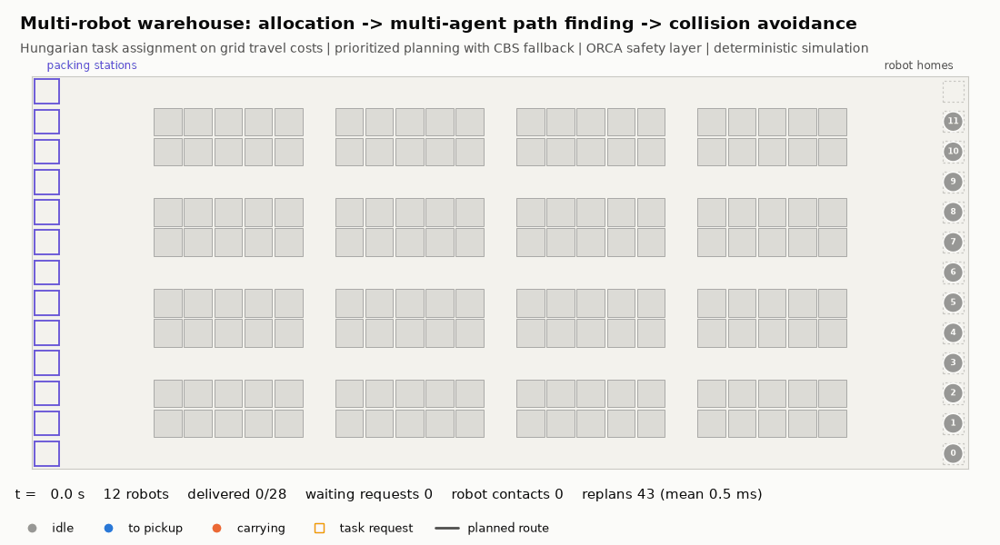

# Integrated warehouse mission: global planning + local avoidance

Scenario: `MultiRobotCore::scenarios` — header `scenarios/warehouse_mission.hpp`;
demo `apps/demos/warehouse.cpp`; ROS 2 front end in `ros2/multirobotcore_ros`.



## Pipeline

```text
task requests (initial batch + Poisson arrivals)
      |
      v
allocation: Hungarian on grid (BFS) travel costs, idle robots x open tasks
      |
      v
MAPF: prioritized planning with random restarts -> CBS fallback
      -> keep previous collision-free plan if both fail
      |
      v
timed waypoints (one cell per step_duration) -> tracking: v_ff + k (p_ref - p)
      |
      v
local safety layer: ORCA (robots + shelf discs, short horizon)
      |
      v
deterministic simulator (or ROS 2 robots)
```

Robots wait at home cells on the right edge, fetch items at shelf access
points and deliver them to packing stations on the left edge. Homes, pickups
and stations are disjoint and goals are unique per robot, so every MAPF
instance is well posed. `WarehouseCoordinator` implements everything above the
safety layer behind `update(time, positions) -> preferred velocities`, so the
same code drives the simulator and the ROS 2 nodes.

## Re-planning model

Planning happens at MAPF step boundaries when something changed (a new
assignment, arrival at a pickup or station, end of a service). Every robot is
re-planned from the cell it occupies **in the current plan** at that step — not
from its measured position — so consecutive plans are consistent and starts
are always distinct. If neither prioritized planning nor CBS finds a plan,
the previous plan (collision free by construction) is kept and planning is
retried at the next step.

## When local avoidance invalidates the global plan

MAPF guarantees collision freedom in the *discrete* model: cells, unit
timesteps, instantaneous moves, robots parked at their goals. Continuous
execution violates these assumptions in several ways, and the mission
reports the consequences instead of hiding them:

| Effect | Consequence | Measured |
|---|---|---|
| Acceleration limits and tracking lag | robots run behind their timed reference; spacing between "following" robots shrinks | max tracking error |
| Without a safety layer | contacts at goal arrivals and tight follows (6–8 contacts in a 120 s run) | robot contacts |
| ORCA modelling only robots | deflections push robots into shelves | shelf contacts |
| ORCA with a long horizon (1.5–2 s) in 1 m aisles | ORCA blocks traffic the plan already resolved; robots fall 8–15 m behind their plans; tasks are left undelivered | tracking error, tasks completed |
| Timer-driven ROS 2 pipeline | variable two-to-three-step latency: 1.4 m tracking error and shelf contacts | ROS launch test |

The configuration used for the demo — robot radius 0.25 m on 1 m cells, ORCA
with shelf obstacles and a 0.6 s horizon, and (in ROS 2) an event-driven
control loop — produced zero robot and shelf contacts across seven seeds with
no planning failures. This is an empirical result for this map and speed, not
a guarantee: ORCA's own guarantee holds only when every robot's linear program
is feasible, and a robot pushed off its timed plan can still meet another
robot in a way the discrete plan did not anticipate. Time-indexed tracking
also means a robot that falls behind tries to catch up, which is what keeps
the discrete schedule meaningful; path-only (untimed) following would lose
that property.

## Results (seed 7, 12 robots, 31 × 13 m)

From `mrc_demo_warehouse` with `configs/warehouse/warehouse_mission.json`:
28/28 requests delivered, mean request-to-delivery time ≈ 44 s, 43 re-plans
with mean planning time below 1 ms, no planning failures, no robot or shelf
contacts, maximum tracking error 0.50 m. Seeds with higher demand saturate
the fleet (about 15 deliveries per minute) and leave requests pending at the
end of the run; they still record zero contacts.

## Validation

`tests/integration/test_warehouse_mission.cpp`: a fixed task set is delivered
completely with prioritized planning and with CBS, every executed plan is
conflict free, there are no contacts, and runs are deterministic. The ROS 2
launch test repeats the end-to-end check through ROS topics.

## Known limitations

- Holonomic robots; one global coordinator (centralised allocation and MAPF).
- Re-planning all robots on every event is simple and fast at this scale
  (sub-millisecond prioritized planning) but not the most scalable strategy;
  windowed/rolling-horizon planners are future work.
- Prioritized planning is incomplete; CBS has a time limit; both can fail in
  congested states, in which case the previous plan is kept.

## References

See [prioritized planning](prioritized_planning.md),
[conflict-based search](conflict_based_search.md),
[reciprocal avoidance](reciprocal_avoidance.md) and
[task allocation](task_allocation.md).
