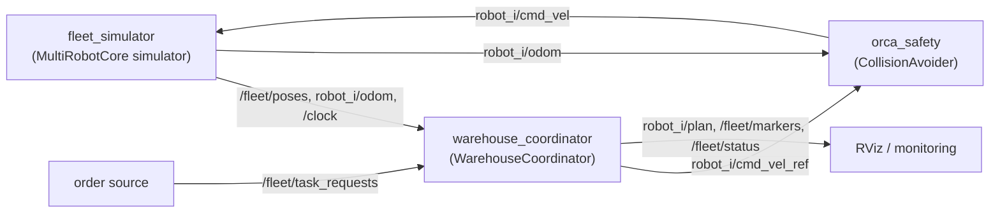

# ROS 2 adapter

The core library is ROS-independent: building, testing, the demos, the
simulator and the benchmarks never require ROS. The optional package
[`ros2/multirobotcore_ros`](../../ros2/multirobotcore_ros/README.md) consumes the
installed core through `find_package(MultiRobotCore)`.

- `fleet_simulator` can be replaced by real robots or Gazebo models that
  publish odometry and accept planar velocity commands.
- `orca_safety` is independent of the warehouse and can protect any fleet.
- The control loop is event driven (one-step latency); a timer-driven
  variant showed tracking errors of 1.4 m and shelf contacts because of
  variable latency — see the [integration notes](../algorithms/warehouse_integration.md).

Verified on ROS 2 Jazzy (Ubuntu 24.04) with `scripts/ci/docker_linux.sh ros2`:
gtest conversion tests and a `launch_testing` end-to-end test (6 robots,
6 tasks delivered, zero contacts, 4× real time).

Future adapters (not implemented): Nav2 integration (global/local planner
plugins), TF broadcasting, Gazebo bridge.
