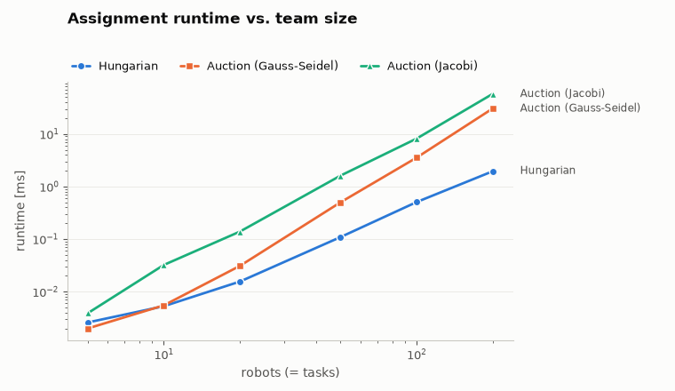
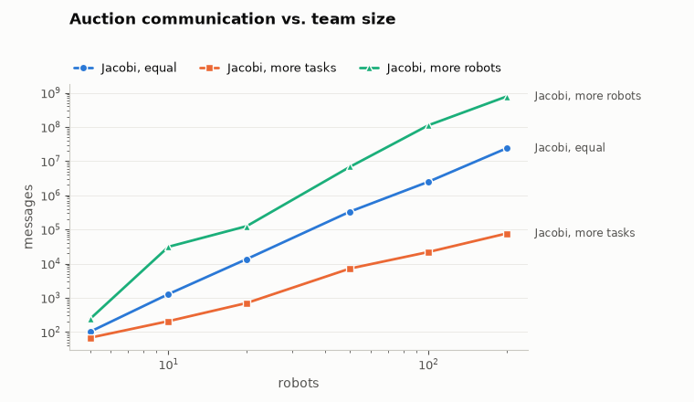

# Task-allocation benchmarks

Generated by `scripts/benchmark/coordination_report.py` from the `mrc_experiment_allocation_benchmark` experiment (configuration `configs/allocation/benchmark.json`; seeds and parameters are also recorded in the result file). Machine: Windows AMD64, CPU only, Release build. Runtimes are wall-clock and indicative only.

Random Euclidean instances in a 50 m square, mean over seeds. Cost is the total robot-to-task distance [m]. The auction uses the default eps (total error at most 0.1% of the largest cost); messages follow the shared-price-board model (one message per bid, one broadcast per price change). Greedy repeatedly takes the globally cheapest remaining pair.

| Algorithm | Robots | Tasks | Cost | Runtime [ms] | Messages |
|---|---|---|---|---|---|
| Hungarian (equal) | 5 | 5 | 86.822 | 0.0026 | - |
| Auction GS (equal) | 5 | 5 | 86.822 | 0.002 | 95 |
| Auction Jacobi (equal) | 5 | 5 | 86.822 | 0.0039 | 102 |
| Greedy (equal) | 5 | 5 | 90.136 | - | - |
| Hungarian (equal) | 10 | 10 | 125 | 0.0053 | - |
| Auction GS (equal) | 10 | 10 | 125 | 0.0055 | 1,302 |
| Auction Jacobi (equal) | 10 | 10 | 125 | 0.0323 | 1,283 |
| Greedy (equal) | 10 | 10 | 146.86 | - | - |
| Hungarian (equal) | 20 | 20 | 196.919 | 0.0156 | - |
| Auction GS (equal) | 20 | 20 | 196.919 | 0.031 | 13,721 |
| Auction Jacobi (equal) | 20 | 20 | 196.919 | 0.139 | 13,587 |
| Greedy (equal) | 20 | 20 | 228.3492 | - | - |
| Hungarian (equal) | 50 | 50 | 349.414 | 0.109 | - |
| Auction GS (equal) | 50 | 50 | 349.414 | 0.502 | 332,408 |
| Auction Jacobi (equal) | 50 | 50 | 349.414 | 1.615 | 333,947 |
| Greedy (equal) | 50 | 50 | 407.539 | - | - |
| Hungarian (equal) | 100 | 100 | 537.762 | 0.507 | - |
| Auction GS (equal) | 100 | 100 | 537.762 | 3.551 | 2,487,832 |
| Auction Jacobi (equal) | 100 | 100 | 537.762 | 8.181 | 2,485,433 |
| Greedy (equal) | 100 | 100 | 663.9156 | - | - |
| Hungarian (equal) | 200 | 200 | 705.508 | 1.955 | - |
| Auction GS (equal) | 200 | 200 | 705.5081 | 30.599 | 23,691,669 |
| Auction Jacobi (equal) | 200 | 200 | 705.5081 | 58.033 | 23,750,409 |
| Greedy (equal) | 200 | 200 | 911.7774 | - | - |
| Hungarian (more_tasks) | 5 | 10 | 53.794 | 0.0028 | - |
| Auction GS (more_tasks) | 5 | 10 | 53.794 | 0.002 | 70 |
| Auction Jacobi (more_tasks) | 5 | 10 | 53.794 | 0.0045 | 68 |
| Greedy (more_tasks) | 5 | 10 | 54.808 | - | - |
| Hungarian (more_tasks) | 10 | 20 | 74.214 | 0.0059 | - |
| Auction GS (more_tasks) | 10 | 20 | 74.214 | 0.0034 | 220 |
| Auction Jacobi (more_tasks) | 10 | 20 | 74.214 | 0.0068 | 207 |
| Greedy (more_tasks) | 10 | 20 | 75.9402 | - | - |
| Hungarian (more_tasks) | 20 | 40 | 94.982 | 0.0108 | - |
| Auction GS (more_tasks) | 20 | 40 | 94.982 | 0.0073 | 735 |
| Auction Jacobi (more_tasks) | 20 | 40 | 94.982 | 0.012 | 703 |
| Greedy (more_tasks) | 20 | 40 | 101.4132 | - | - |
| Hungarian (more_tasks) | 50 | 100 | 150.492 | 0.0592 | - |
| Auction GS (more_tasks) | 50 | 100 | 150.492 | 0.0517 | 7,568 |
| Auction Jacobi (more_tasks) | 50 | 100 | 150.492 | 0.0754 | 7,200 |
| Greedy (more_tasks) | 50 | 100 | 157.7803 | - | - |
| Hungarian (more_tasks) | 100 | 200 | 219.641 | 0.244 | - |
| Auction GS (more_tasks) | 100 | 200 | 219.641 | 0.144 | 22,361 |
| Auction Jacobi (more_tasks) | 100 | 200 | 219.641 | 0.18 | 21,872 |
| Greedy (more_tasks) | 100 | 200 | 228.7429 | - | - |
| Hungarian (more_tasks) | 200 | 400 | 298.609 | 0.625 | - |
| Auction GS (more_tasks) | 200 | 400 | 298.609 | 0.376 | 75,536 |
| Auction Jacobi (more_tasks) | 200 | 400 | 298.609 | 0.447 | 76,285 |
| Greedy (more_tasks) | 200 | 400 | 314.3337 | - | - |
| Hungarian (more_robots) | 5 | 2 | 21.583 | 0.0011 | - |
| Auction GS (more_robots) | 5 | 2 | 21.583 | 0.0016 | 197 |
| Auction Jacobi (more_robots) | 5 | 2 | 21.583 | 0.0067 | 243 |
| Greedy (more_robots) | 5 | 2 | 21.583 | - | - |
| Hungarian (more_robots) | 10 | 5 | 52.48 | 0.0021 | - |
| Auction GS (more_robots) | 10 | 5 | 52.48 | 0.0234 | 20,867 |
| Auction Jacobi (more_robots) | 10 | 5 | 52.48 | 0.211 | 31,110 |
| Greedy (more_robots) | 10 | 5 | 53.5306 | - | - |
| Hungarian (more_robots) | 20 | 10 | 61.425 | 0.0059 | - |
| Auction GS (more_robots) | 20 | 10 | 61.425 | 0.202 | 122,590 |
| Auction Jacobi (more_robots) | 20 | 10 | 61.425 | 0.519 | 125,012 |
| Greedy (more_robots) | 20 | 10 | 62.4047 | - | - |
| Hungarian (more_robots) | 50 | 25 | 103.553 | 0.025 | - |
| Auction GS (more_robots) | 50 | 25 | 103.553 | 6.316 | 5,799,700 |
| Auction Jacobi (more_robots) | 50 | 25 | 103.553 | 20.851 | 6,853,220 |
| Greedy (more_robots) | 50 | 25 | 108.3361 | - | - |
| Hungarian (more_robots) | 100 | 50 | 164.889 | 0.0935 | - |
| Auction GS (more_robots) | 100 | 50 | 164.889 | 90.518 | 98,228,297 |
| Auction Jacobi (more_robots) | 100 | 50 | 164.889 | 237.789 | 112,008,191 |
| Greedy (more_robots) | 100 | 50 | 172.9438 | - | - |
| Hungarian (more_robots) | 200 | 100 | 207.105 | 0.276 | - |
| Auction GS (more_robots) | 200 | 100 | 207.105 | 623.285 | 771,232,538 |
| Auction Jacobi (more_robots) | 200 | 100 | 207.105 | 1,367 | 779,352,163 |
| Greedy (more_robots) | 200 | 100 | 214.1466 | - | - |

The auction reaches the optimum within its eps bound in every case. Its cost is communication: when robots outnumber tasks they bid prices up through many small increments (price wars), so rounds and messages grow by orders of magnitude while the centralised Hungarian method stays below a few milliseconds. The distributed method is not expected to beat the centralised optimum; it trades runtime and messages for decentralised decision making.

## Dynamic arrivals

Eight robots, Poisson task arrivals (0.6 tasks/s for 120 s); dynamic reallocation with a 1 m commitment radius and different switching penalties.

| Switching penalty | Mean completion [s] | Max completion [s] | Reassignments |
|---|---|---|---|
| 0.0 | 3.978 | 10.554 | 14.8 |
| 0.5 | 3.881 | 10.069 | 9.2 |
| 2.0 | 3.984 | 9.672 | 4.4 |
| 5.0 | 4.08 | 9.803 | 1.6 |

A small penalty removes most reassignments (thrashing) without hurting completion times.

## Multiple tasks per robot (SSI auctions)

| Objective | Robots | Tasks | Total length [m] | Longest route [m] | Runtime [ms] |
|---|---|---|---|---|---|
| minisum | 5 | 25 | 114.263 | 40.122 | 0.253 |
| minimax | 5 | 25 | 126.269 | 31.637 | 0.274 |

MiniMax bids trade total travel for a shorter longest route (makespan proxy).
