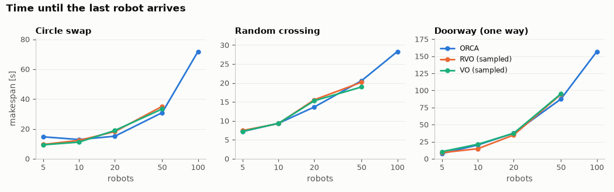
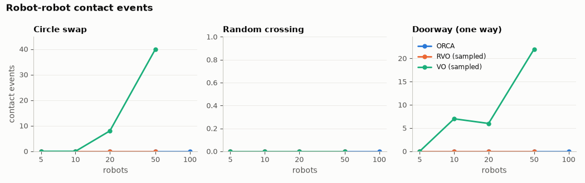
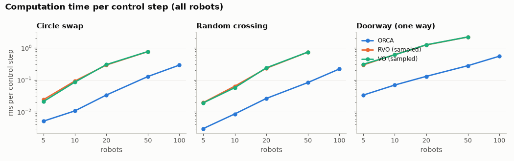

# Collision-avoidance benchmark

<!-- Generated by scripts/benchmark/avoidance_report.py; do not edit by hand. -->

Deterministic simulator runs (`apps/benchmarks/avoidance_benchmark.cpp`, configuration `configs/avoidance/benchmark.json`, seed 11). Disc robots of radius 0.25 m, maximum speed 1.0 m/s, control period 0.05 s, single-integrator dynamics. Preferred velocities point at the goal (via door waypoints in the doorway scenario) and carry 0.05 m/s of seeded noise to break exact symmetries. Avoidance parameters: tau = 4.0 s (obstacles 1.0 s), sensing radius 6.0 m, at most 16 neighbours, safety margin 0.02 m; sampled methods use 5 x 24 candidate velocities.

Metric definitions: *success* = every robot reached its goal with zero contact events; *contacts* are simulator contact events (a pair entering overlap, or a robot touching an obstacle/boundary); *min clearance* is the smallest surface-to-surface distance between robots; *path efficiency* is straight-line distance divided by travelled distance; *velocity deviation* is the mean of ||v - v_pref||; *stall* is the simulator heuristic (all active robots moved less than 5 cm in 4 s), which ends the run. Compute time is the wall-clock time of the whole control loop per step on the benchmark machine, single threaded; neighbour search is brute force O(N^2).

## Circle swap

| Method | Robots | Success | Reached | Contacts (robot / obstacle) | Min clearance [m] | Makespan [s] | Mean time to goal [s] | Path efficiency | Velocity deviation [m/s] | Stall | Compute [ms/step] |
|---|---:|:---:|---:|---:|---:|---:|---:|---:|---:|:---:|---:|
| ORCA | 5 | yes | 5/5 | 0 / 0 | 0.040 | 14.7 | 14.7 | 0.997 | 0.441 | no | 0.005 |
| RVO (sampled) | 5 | yes | 5/5 | 0 / 0 | 0.046 | 9.6 | 9.5 | 0.980 | 0.193 | no | 0.024 |
| VO (sampled) | 5 | yes | 5/5 | 0 / 0 | 0.040 | 9.3 | 9.1 | 0.986 | 0.141 | no | 0.021 |
| ORCA | 10 | yes | 10/10 | 0 / 0 | 0.040 | 12.9 | 11.4 | 0.980 | 0.259 | no | 0.011 |
| RVO (sampled) | 10 | yes | 10/10 | 0 / 0 | 0.044 | 12.3 | 11.4 | 0.934 | 0.299 | no | 0.092 |
| VO (sampled) | 10 | yes | 10/10 | 0 / 0 | 0.022 | 11.2 | 10.4 | 0.928 | 0.248 | no | 0.085 |
| ORCA | 20 | yes | 20/20 | 0 / 0 | 0.039 | 15.1 | 12.1 | 0.957 | 0.273 | no | 0.034 |
| RVO (sampled) | 20 | yes | 20/20 | 0 / 0 | 0.049 | 18.2 | 14.4 | 0.871 | 0.368 | no | 0.291 |
| VO (sampled) | 20 | no | 20/20 | 8 / 0 | -0.049 | 18.9 | 16.0 | 0.714 | 0.461 | no | 0.300 |
| ORCA | 50 | yes | 50/50 | 0 / 0 | 0.024 | 30.9 | 22.9 | 0.916 | 0.250 | no | 0.128 |
| RVO (sampled) | 50 | yes | 50/50 | 0 / 0 | 0.036 | 35.1 | 28.1 | 0.858 | 0.373 | no | 0.767 |
| VO (sampled) | 50 | no | 50/50 | 40 / 0 | -0.064 | 33.4 | 28.8 | 0.740 | 0.433 | no | 0.772 |
| ORCA | 100 | no | 93/100 | 0 / 0 | 0.010 | 71.8 | 58.6 | 0.906 | 0.400 | no | 0.290 |

## Random crossing

| Method | Robots | Success | Reached | Contacts (robot / obstacle) | Min clearance [m] | Makespan [s] | Mean time to goal [s] | Path efficiency | Velocity deviation [m/s] | Stall | Compute [ms/step] |
|---|---:|:---:|---:|---:|---:|---:|---:|---:|---:|:---:|---:|
| ORCA | 5 | yes | 5/5 | 0 / 0 | 0.040 | 7.2 | 4.5 | 0.883 | 0.106 | no | 0.003 |
| RVO (sampled) | 5 | yes | 5/5 | 0 / 0 | 0.049 | 7.5 | 4.7 | 0.935 | 0.050 | no | 0.019 |
| VO (sampled) | 5 | yes | 5/5 | 0 / 0 | 0.046 | 7.2 | 4.6 | 0.950 | 0.042 | no | 0.019 |
| ORCA | 10 | yes | 10/10 | 0 / 0 | 0.040 | 9.3 | 5.5 | 0.880 | 0.080 | no | 0.009 |
| RVO (sampled) | 10 | yes | 10/10 | 0 / 0 | 0.054 | 9.3 | 5.5 | 0.932 | 0.050 | no | 0.064 |
| VO (sampled) | 10 | yes | 10/10 | 0 / 0 | 0.026 | 9.3 | 5.4 | 0.915 | 0.053 | no | 0.057 |
| ORCA | 20 | yes | 20/20 | 0 / 0 | 0.040 | 13.7 | 8.2 | 0.918 | 0.070 | no | 0.026 |
| RVO (sampled) | 20 | yes | 20/20 | 0 / 0 | 0.044 | 15.6 | 8.3 | 0.917 | 0.073 | no | 0.230 |
| VO (sampled) | 20 | yes | 20/20 | 0 / 0 | 0.023 | 15.3 | 8.1 | 0.921 | 0.055 | no | 0.238 |
| ORCA | 50 | yes | 50/50 | 0 / 0 | 0.040 | 20.6 | 10.1 | 0.833 | 0.150 | no | 0.083 |
| RVO (sampled) | 50 | yes | 50/50 | 0 / 0 | 0.038 | 20.2 | 9.9 | 0.876 | 0.116 | no | 0.739 |
| VO (sampled) | 50 | yes | 50/50 | 0 / 0 | 0.022 | 18.9 | 9.5 | 0.881 | 0.096 | no | 0.743 |
| ORCA | 100 | yes | 100/100 | 0 / 0 | 0.038 | 28.3 | 13.2 | 0.840 | 0.109 | no | 0.219 |

## Doorway (one way)

| Method | Robots | Success | Reached | Contacts (robot / obstacle) | Min clearance [m] | Makespan [s] | Mean time to goal [s] | Path efficiency | Velocity deviation [m/s] | Stall | Compute [ms/step] |
|---|---:|:---:|---:|---:|---:|---:|---:|---:|---:|:---:|---:|
| ORCA | 5 | yes | 5/5 | 0 / 0 | 0.040 | 7.7 | 6.5 | 0.901 | 0.141 | no | 0.033 |
| RVO (sampled) | 5 | yes | 5/5 | 0 / 0 | 0.036 | 8.8 | 7.7 | 0.874 | 0.240 | no | 0.293 |
| VO (sampled) | 5 | no | 5/5 | 0 / 1 | 0.021 | 10.5 | 8.3 | 0.744 | 0.271 | no | 0.308 |
| ORCA | 10 | yes | 10/10 | 0 / 0 | 0.039 | 20.2 | 14.8 | 0.677 | 0.556 | no | 0.069 |
| RVO (sampled) | 10 | yes | 10/10 | 0 / 0 | 0.041 | 14.8 | 10.4 | 0.779 | 0.382 | no | 0.617 |
| VO (sampled) | 10 | no | 10/10 | 7 / 0 | -0.036 | 21.2 | 11.1 | 0.604 | 0.329 | no | 0.608 |
| ORCA | 20 | yes | 20/20 | 0 / 0 | 0.033 | 37.5 | 19.5 | 0.661 | 0.428 | no | 0.129 |
| RVO (sampled) | 20 | no | 19/20 | 0 / 0 | 0.043 | 34.8 | 19.3 | 0.610 | 0.541 | yes | 1.235 |
| VO (sampled) | 20 | no | 20/20 | 6 / 0 | -0.089 | 37.3 | 17.0 | 0.547 | 0.362 | no | 1.253 |
| ORCA | 50 | yes | 50/50 | 0 / 0 | 0.022 | 87.6 | 40.5 | 0.557 | 0.440 | no | 0.278 |
| RVO (sampled) | 50 | no | 49/50 | 0 / 0 | 0.041 | 94.5 | 36.2 | 0.520 | 0.428 | yes | 2.197 |
| VO (sampled) | 50 | no | 50/50 | 22 / 1 | -0.067 | 95.2 | 35.0 | 0.425 | 0.363 | no | 2.198 |
| ORCA | 100 | no | 100/100 | 0 / 1 | 0.020 | 157.0 | 67.2 | 0.582 | 0.375 | no | 0.550 |

## Reading the results

- Velocity obstacles assume the other robot keeps its velocity. Two robots that both avoid therefore over-react and oscillate, and in crowded scenes VO produces contact events. RVO and ORCA share the avoidance effort and avoid these artefacts.
- ORCA's guarantee (no collision within tau) holds when every robot's linear program is feasible and neighbourhoods are mutual. In dense crowds the program becomes infeasible and the fallback minimises the largest constraint violation, so small overlaps become possible; the safety margin absorbs most of them.
- Local methods have no global awareness. One-way flow through a door works with a waypoint route, but counterflow through the same door or a single-file corridor swap congests or deadlocks (see `docs/assets/avoidance_bottleneck.gif`). These cases require coordination at the planning level (e.g. multi-agent path finding) rather than better local avoidance.
- A stall flags the heuristic condition described above; it is not a formal deadlock proof.
