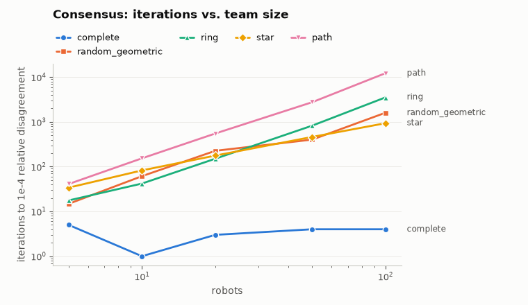
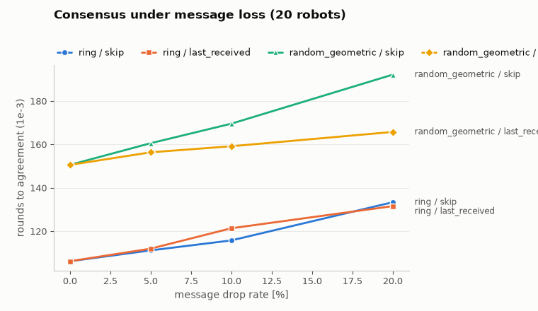

# Consensus benchmarks

Generated by `scripts/benchmark/coordination_report.py` from the `mrc_experiment_consensus_benchmark` experiment (configuration `configs/consensus/benchmark.json`; seeds and parameters are also recorded in the result file). Machine: Windows AMD64, CPU only, Release build. Runtimes are wall-clock and indicative only.

Synchronous discrete consensus `x(k+1) = (I - eps L) x(k)` with `eps = 0.9 / d_max`, initial values uniform in [0, 10], stopping at a disagreement of 1e-4 of the initial range. Messages count one value per directed edge per round. Mean over seeds.

| Topology | Robots | lambda_2 | Iterations | Messages | Runtime [ms] |
|---|---|---|---|---|---|
| complete | 5 | 5 | 5 | 100 | 0.0014 |
| complete | 10 | 10 | 1 | 90 | 0.0008 |
| complete | 20 | 20 | 3 | 1,140 | 0.0036 |
| complete | 50 | 50 | 4 | 9,800 | 0.0194 |
| complete | 100 | 100 | 4 | 39,600 | 0.0727 |
| random_geometric | 5 | 2.953 | 14.8 | 170 | 0.0032 |
| random_geometric | 10 | 1.043 | 61.4 | 2,512 | 0.0137 |
| random_geometric | 20 | 0.349 | 226.2 | 21,334 | 0.101 |
| random_geometric | 50 | 0.167 | 403 | 133,595 | 0.31 |
| random_geometric | 100 | 0.068 | 1,604 | 1,098,330 | 2.237 |
| ring | 5 | 1.382 | 17.6 | 176 | 0.0038 |
| ring | 10 | 0.382 | 42 | 840 | 0.0103 |
| ring | 20 | 0.0979 | 150.6 | 6,024 | 0.0464 |
| ring | 50 | 0.0158 | 825.2 | 82,520 | 0.421 |
| ring | 100 | 0.00395 | 3,531 | 706,120 | 3.122 |
| star | 5 | 1 | 34 | 272 | 0.0065 |
| star | 10 | 1 | 82.6 | 1,487 | 0.0185 |
| star | 20 | 1 | 177 | 6,726 | 0.0515 |
| star | 50 | 1 | 462.2 | 45,296 | 0.233 |
| star | 100 | 1 | 936.2 | 185,368 | 0.835 |
| path | 5 | 0.382 | 41 | 328 | 0.0075 |
| path | 10 | 0.0979 | 153.8 | 2,768 | 0.0315 |
| path | 20 | 0.0246 | 550.8 | 20,930 | 0.144 |
| path | 50 | 0.00395 | 2,757 | 270,225 | 1.437 |
| path | 100 | 0.00099 | 12,268 | 2,429,104 | 11.154 |

Iterations scale with `1 / (eps * lambda_2)`: complete graphs agree in a handful of rounds while paths and rings slow down quadratically with team size, exactly as the spectral bound predicts.

## Robustness to message loss

Message-passing consensus through the network simulator with independent random loss. *skip* omits a neighbour whose message was lost; *last_received* reuses its most recent value. Bias is the distance between the agreement value and the initial average, relative to the initial range: lossy exchanges are not symmetric, so the average is no longer preserved exactly.

| Topology | Policy | Drop rate | Rounds | Bias | Delivered | Failures |
|---|---|---|---|---|---|---|
| ring | skip | 0% | 106.2 | 0.00% | 100.0% | 0 |
| ring | skip | 5% | 111.2 | 1.46% | 95.0% | 0 |
| ring | skip | 10% | 115.8 | 0.78% | 90.1% | 0 |
| ring | skip | 20% | 133.4 | 2.59% | 80.1% | 0 |
| ring | last_received | 0% | 106.2 | 0.00% | 100.0% | 0 |
| ring | last_received | 5% | 112 | 1.55% | 95.0% | 0 |
| ring | last_received | 10% | 121.4 | 1.54% | 90.1% | 0 |
| ring | last_received | 20% | 131.6 | 2.49% | 80.2% | 0 |
| random_geometric | skip | 0% | 150.6 | 0.00% | 100.0% | 0 |
| random_geometric | skip | 5% | 160.6 | 0.68% | 95.0% | 0 |
| random_geometric | skip | 10% | 169.6 | 0.85% | 89.8% | 0 |
| random_geometric | skip | 20% | 192.2 | 0.85% | 79.8% | 0 |
| random_geometric | last_received | 0% | 150.6 | 0.00% | 100.0% | 0 |
| random_geometric | last_received | 5% | 156.4 | 0.53% | 95.0% | 0 |
| random_geometric | last_received | 10% | 159.2 | 0.64% | 89.8% | 0 |
| random_geometric | last_received | 20% | 165.8 | 0.91% | 79.7% | 0 |

Agreement is still reached under 20% loss (the union of effective graphs stays connected), at the cost of more rounds and a small bias. These results do not imply guarantees beyond the assumptions of the joint-connectivity results cited in the consensus documentation.
