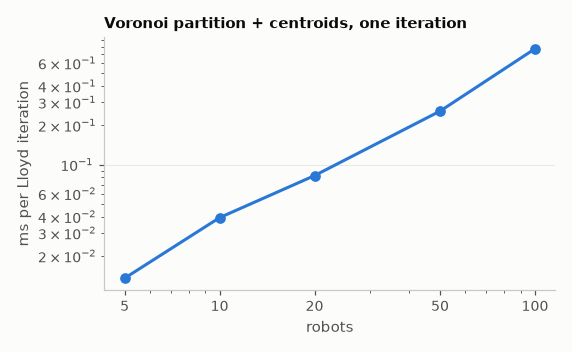
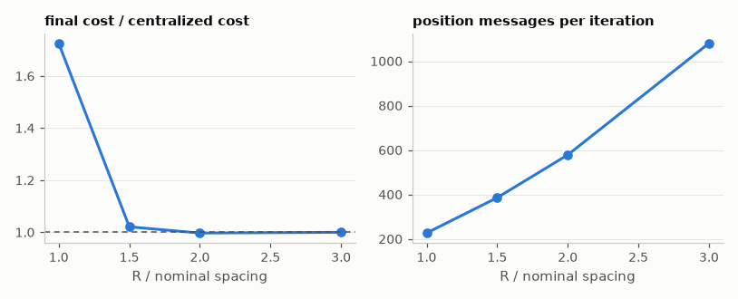

# Coverage benchmark

Generated by `python scripts/benchmark/coverage_benchmark.py` from
`mrc_experiment_coverage_benchmark` (configs/coverage/benchmark.json). Release build, single thread,
Windows AMD64. Values are means over seeds
[1, 2, 3].

Setup: 20 m x 20 m square, two-bump Gaussian
density with a constant floor, robots initially uniform at random. Discrete
Lloyd iterations (every robot moves to its density-weighted cell centroid)
until the largest centroid distance falls below 1 % of the nominal cell size
`side / sqrt(N)`, or 300 iterations.

## Scalability

| Robots | Converged | Lloyd iterations | Time / iteration [ms] | Initial cost | Final cost | Mean distance [m] | Max uncovered [m] | Min separation [m] |
|---:|:---:|---:|---:|---:|---:|---:|---:|---:|
| 5 | 3/3 | 18 | 0.013 | 10703 | 2952.8 | 2.625 | 9.195 | 4.231 |
| 10 | 3/3 | 18 | 0.039 | 5114 | 1586.8 | 1.945 | 5.964 | 3.564 |
| 20 | 3/3 | 46 | 0.082 | 2512 | 825.9 | 1.414 | 4.946 | 2.651 |
| 50 | 3/3 | 52 | 0.257 | 807 | 335.2 | 0.907 | 2.826 | 1.693 |
| 100 | 3/3 | 101 | 0.772 | 460 | 167.9 | 0.645 | 1.939 | 1.210 |

Each cell sorts the other N - 1 generators by distance (O(N log N) per cell,
O(N^2 log N) per partition) but clips against only the few nearest ones,
because clipping stops once no farther bisector can intersect the cell;
quadrature is O(N) with a constant set by the subdivision level. Over this
range the measured time per iteration grows roughly like N^1.4. A spatial
index (k-d tree or Delaunay neighbours) would remove the quadratic sorting
term for much larger teams.

## Limited communication range

50 robots, 200 Lloyd iterations of the r-limited controller (each
robot uses its Voronoi cell intersected with B(p_i, R/2)), compared with the
centralized partition from the same start. Nominal spacing
`side / sqrt(N)` = 2.83 m.

| R / spacing | R [m] | Certified-exact cells | Cost / centralized cost | Max exact-centroid error [m] | Position messages / iteration |
|---:|---:|---:|---:|---:|---:|
| 1.0 | 2.83 | 45 % | 1.726 | 1.615 | 227 |
| 1.5 | 4.24 | 53 % | 1.021 | 0.429 | 386 |
| 2.0 | 5.66 | 99 % | 0.997 | 0.011 | 578 |
| 3.0 | 8.48 | 100 % | 1.000 | 0.009 | 1081 |

With R of about twice the spacing every cell fits in its R/2 disc, the local
computation is exact and the result matches the centralized optimum at about
half the message load of R = 3x spacing. With R equal to the spacing, robots
optimise the limited-range cost: they stop spreading once their R/2 discs are
well placed, which leaves a visibly higher coverage cost (a known property of
the limited-range objective, not a numerical failure).
