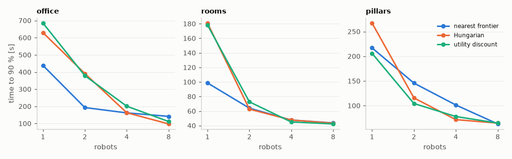
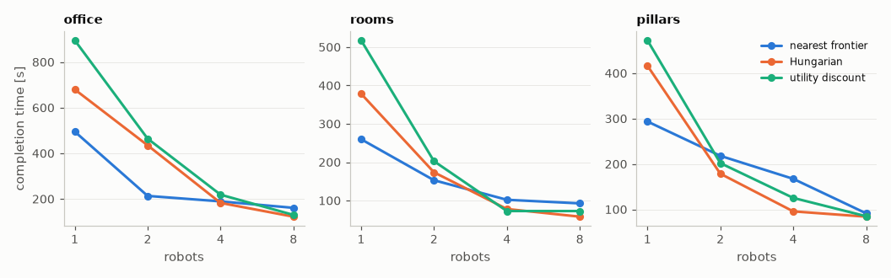

# Exploration benchmark

Generated by `python scripts/benchmark/exploration_benchmark.py` from
`mrc_experiment_exploration_benchmark` (configs/exploration/benchmark.json). Release build, single thread,
Windows AMD64. Means over seeds [1, 2, 3]; each seed draws the
start cells at random inside a 3-cell disc around the map's start point.

Setup: grid resolution 0.5 m, robot speed 0.5 m/s (one cell per
1 s step), noise-free 3.0 m range sensor with
180 beams, shared map, re-planning every 8 steps or when a target
stops being a frontier. Coverage is measured on the free space reachable from the starts.
Robots are points on the grid (inter-robot collisions are not modelled here).

| Map | Robots | Strategy | Complete | Time to 90 % [s] | Time to 95 % [s] | Completion [s] | Distance [m] | Redundant cells | Messages | Planner runtime [ms] |
|---|---:|---|:---:|---:|---:|---:|---:|---:|---:|---:|
| office | 1 | nearest frontier | 3/3 | 439 | 479 | 495 | 248 | 0 % | 508 | 14.4 |
| office | 1 | Hungarian | 3/3 | 630 | 663 | 680 | 340 | 0 % | 520 | 17.0 |
| office | 1 | utility discount | 3/3 | 686 | 716 | 896 | 448 | 0 % | 561 | 22.1 |
| office | 2 | nearest frontier | 3/3 | 193 | 201 | 213 | 213 | 21 % | 589 | 13.5 |
| office | 2 | Hungarian | 3/3 | 391 | 418 | 435 | 435 | 64 % | 702 | 21.7 |
| office | 2 | utility discount | 3/3 | 379 | 406 | 464 | 464 | 69 % | 691 | 22.5 |
| office | 4 | nearest frontier | 3/3 | 162 | 175 | 189 | 379 | 61 % | 840 | 22.4 |
| office | 4 | Hungarian | 3/3 | 163 | 171 | 183 | 365 | 50 % | 857 | 25.1 |
| office | 4 | utility discount | 3/3 | 201 | 209 | 219 | 437 | 50 % | 847 | 27.0 |
| office | 8 | nearest frontier | 3/3 | 142 | 149 | 161 | 644 | 72 % | 1329 | 35.3 |
| office | 8 | Hungarian | 3/3 | 98 | 108 | 122 | 489 | 61 % | 1138 | 33.1 |
| office | 8 | utility discount | 3/3 | 112 | 118 | 130 | 520 | 70 % | 1191 | 36.7 |
| rooms | 1 | nearest frontier | 3/3 | 99 | 188 | 260 | 130 | 0 % | 308 | 7.3 |
| rooms | 1 | Hungarian | 3/3 | 181 | 218 | 379 | 189 | 0 % | 329 | 9.3 |
| rooms | 1 | utility discount | 3/3 | 178 | 224 | 518 | 259 | 0 % | 355 | 11.6 |
| rooms | 2 | nearest frontier | 3/3 | 64 | 75 | 153 | 153 | 59 % | 340 | 7.4 |
| rooms | 2 | Hungarian | 3/3 | 63 | 90 | 174 | 174 | 40 % | 366 | 8.2 |
| rooms | 2 | utility discount | 3/3 | 73 | 95 | 203 | 203 | 65 % | 381 | 9.0 |
| rooms | 4 | nearest frontier | 3/3 | 48 | 54 | 102 | 204 | 71 % | 438 | 10.2 |
| rooms | 4 | Hungarian | 3/3 | 48 | 55 | 78 | 156 | 58 % | 432 | 9.1 |
| rooms | 4 | utility discount | 3/3 | 45 | 49 | 73 | 145 | 56 % | 402 | 8.3 |
| rooms | 8 | nearest frontier | 3/3 | 44 | 50 | 93 | 371 | 91 % | 701 | 15.9 |
| rooms | 8 | Hungarian | 3/3 | 43 | 48 | 58 | 232 | 91 % | 649 | 12.8 |
| rooms | 8 | utility discount | 3/3 | 42 | 47 | 73 | 291 | 93 % | 644 | 16.1 |
| pillars | 1 | nearest frontier | 3/3 | 217 | 227 | 294 | 147 | 0 % | 363 | 8.4 |
| pillars | 1 | Hungarian | 3/3 | 267 | 293 | 417 | 208 | 0 % | 388 | 9.9 |
| pillars | 1 | utility discount | 3/3 | 206 | 246 | 473 | 236 | 0 % | 403 | 10.7 |
| pillars | 2 | nearest frontier | 3/3 | 146 | 169 | 218 | 218 | 68 % | 465 | 10.6 |
| pillars | 2 | Hungarian | 3/3 | 116 | 127 | 179 | 179 | 20 % | 436 | 9.7 |
| pillars | 2 | utility discount | 3/3 | 104 | 112 | 202 | 202 | 42 % | 437 | 10.1 |
| pillars | 4 | nearest frontier | 3/3 | 101 | 114 | 167 | 335 | 80 % | 687 | 14.9 |
| pillars | 4 | Hungarian | 3/3 | 72 | 80 | 96 | 191 | 60 % | 572 | 10.8 |
| pillars | 4 | utility discount | 3/3 | 78 | 86 | 125 | 251 | 68 % | 610 | 13.3 |
| pillars | 8 | nearest frontier | 3/3 | 63 | 71 | 91 | 365 | 79 % | 887 | 18.6 |
| pillars | 8 | Hungarian | 3/3 | 65 | 73 | 84 | 336 | 82 % | 912 | 18.5 |
| pillars | 8 | utility discount | 3/3 | 65 | 73 | 85 | 340 | 97 % | 908 | 20.4 |

## Observations

* With a single robot the nearest-frontier rule is fastest on every map: the
  information-gain term of the other strategies pulls a lone robot toward large
  but distant frontiers, which costs travel without a coordination benefit.
* Coordination pays off as the team grows. With eight robots the Hungarian
  assignment completes the office in 122 s versus 161 s for the uncoordinated
  rule and the rooms map in 58 s versus 93 s; with four robots on the pillars
  map it completes in 96 s versus 167 s.
* The benefit is not uniform: with two robots on the office map the
  uncoordinated rule is about twice as fast, because sending the second robot
  to a distant frontier (to avoid duplication) costs more than sharing the
  nearby rooms.
* The Hungarian assignment usually lowers redundant observation, while the
  utility-discount rule does not reduce it consistently on these small maps
  (robots start together, so the start area is observed by everyone).
* Completion time is dominated by the last small frontier pockets
  ("cleanup"), which is why the time to 90 % and the completion time can rank
  strategies differently.
