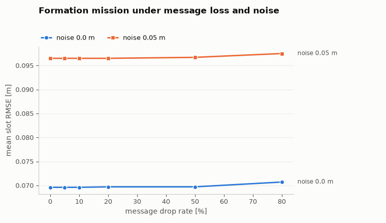

# Formation benchmarks

Generated by `scripts/benchmark/coordination_report.py` from the `mrc_experiment_formation_benchmark` experiment (configuration `configs/formation/benchmark.json`; seeds and parameters are also recorded in the result file). Machine: Windows AMD64, CPU only, Release build. Runtimes are wall-clock and indicative only.

Seven single-integrator robots start from random perturbations (+-1.5 m) of the desired shape and run for 40 s with a 1 m/s speed limit. Leader-follower and consensus (pinned at robot 0, ring graph) are measured against the absolute slots; the distance-based law (Henneberg graph) only controls inter-robot distances and is measured after the best rigid alignment. Convergence means RMSE < 5 cm until the end of the run.

| Controller | Formation | Formation RMSE [m] | Convergence | Min Distance [m] |
|---|---|---|---|---|
| leader-follower | line | 0 | 3.1 s (10/10) | 0.231 |
| consensus | line | 0.0098 | 19.1 s (10/10) | 0.13 |
| distance | line | 0.332 | not converged (0/10) | 0.287 |
| leader-follower | v | 0 | 3.1 s (10/10) | 0.123 |
| consensus | v | 0.0098 | 19.1 s (10/10) | 0.0944 |
| distance | v | 0.329 | 16.9 s (2/10) | 0.092 |
| leader-follower | circle | 0 | 3.1 s (10/10) | 0.108 |
| consensus | circle | 0.0098 | 19.1 s (10/10) | 0.0142 |
| distance | circle | 0.472 | not converged (0/10) | 0.0146 |

The distance-based law cannot stabilise collinear formations (line): the framework is not infinitesimally rigid, so distances alone do not determine the shape. Pure formation laws do not model robot size; minimum distances below 2 r indicate where a safety layer (separation barrier, velocity obstacles) is required.

## Moving leader

| Leader-follower | Leader speed [m/s] | Steady-state RMSE [m] |
|---|---|---|
| with feedforward | 0.5 | 0 |
| without feedforward | 0.5 | 0.463 |

Without velocity feedforward the steady-state lag equals `v / k` (0.5 m/s, k = 1).

## Topology changes

Consensus formation where every edge of the complete graph drops out independently at every control step.

| Edge dropout | Final RMSE [m] | Converged runs |
|---|---|---|
| 0% | 0.0048 | 10/10 |
| 30% | 0.0071 | 10/10 |
| 60% | 0.015 | 10/10 |
| 90% | 0.104 | 2/10 |

## Integrated mission robustness

The passage mission (gather, V, column, V) with lossy leader-state relay and Gaussian noise on position estimates.

| Drop rate | Noise [m] | Mean RMSE [m] | Path progress | Contacts | Messages |
|---|---|---|---|---|---|
| 0% | 0.0 | 0.0696 | 99.6% | 0 | 69,112 |
| 5% | 0.0 | 0.0696 | 99.6% | 0 | 69,110 |
| 10% | 0.0 | 0.0696 | 99.6% | 0 | 69,110 |
| 20% | 0.0 | 0.0697 | 99.6% | 0 | 69,106 |
| 50% | 0.0 | 0.0697 | 99.6% | 0 | 69,087 |
| 80% | 0.0 | 0.0707 | 99.6% | 0 | 68,973 |
| 0% | 0.05 | 0.0965 | 99.6% | 0 | 69,105 |
| 5% | 0.05 | 0.0965 | 99.6% | 0 | 69,103 |
| 10% | 0.05 | 0.0965 | 99.6% | 0 | 69,103 |
| 20% | 0.05 | 0.0965 | 99.6% | 0 | 69,099 |
| 50% | 0.05 | 0.0967 | 99.6% | 0 | 69,079 |
| 80% | 0.05 | 0.0975 | 99.6% | 0 | 68,964 |

