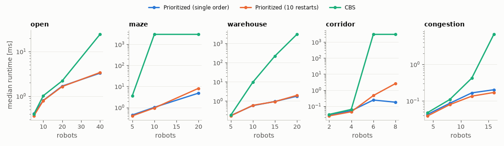
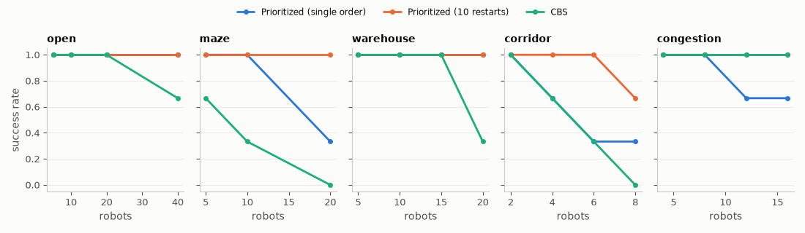
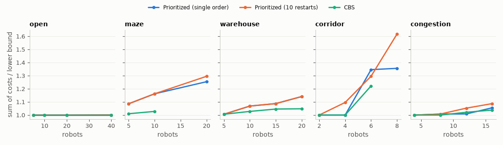

# MAPF benchmark

Generated by `scripts/benchmark/mapf_benchmark.py` from `mrc_experiment_mapf_benchmark` (configuration `configs/mapf/benchmark.json`). Do not edit by hand.

- Instances: 3 seeds per (map, team size); random starts/goals in the largest connected component (warehouse: station columns to shelf access cells).
- CBS wall-clock limit: 3.0 s per instance; timeouts are reported, not hidden. Prioritized restarts: up to 10 orderings (shortest-first, then seeded random).
- Runtime: median over all runs of the cell, including timeouts at the limit. Sum of costs, makespan and SOC / bound: mean over solved runs only. SOC / bound divides by the independent (uncoordinated) sum of costs, a lower bound on every collision-free solution.
- Independent A* ignores the other robots; its 'Conflicts' column counts the collisions it would cause.
- Single-threaded, CPU only; absolute times depend on the machine and compiler.

## Open

| Planner | Robots | Success | Runtime [ms] | Sum Cost | Makespan | SOC / bound | Conflicts | CT nodes | LL expansions |
|---|---:|---|---:|---:|---:|---:|---:|---:|---:|
| Independent A* (unsafe) | 5 | n/a (unsafe) | 0.37 | 105.7 | 34.0 | 1.000 | 0.0 | - | 111 |
| Independent A* (unsafe) | 10 | n/a (unsafe) | 0.67 | 222.7 | 42.3 | 1.000 | 1.0 | - | 233 |
| Independent A* (unsafe) | 20 | n/a (unsafe) | 1.45 | 448.7 | 44.0 | 1.000 | 5.0 | - | 469 |
| Independent A* (unsafe) | 40 | n/a (unsafe) | 2.54 | 836.7 | 44.0 | 1.000 | 20.0 | - | 877 |
| Prioritized (single order) | 5 | 3/3 | 0.40 | 105.7 | 34.0 | 1.000 | 0.0 | - | 111 |
| Prioritized (single order) | 10 | 3/3 | 0.80 | 222.7 | 42.3 | 1.000 | 0.0 | - | 241 |
| Prioritized (single order) | 20 | 3/3 | 1.68 | 448.7 | 44.0 | 1.000 | 0.0 | - | 493 |
| Prioritized (single order) | 40 | 3/3 | 3.28 | 837.3 | 44.0 | 1.001 | 0.0 | - | 1017 |
| Prioritized (10 restarts) | 5 | 3/3 | 0.36 | 105.7 | 34.0 | 1.000 | 0.0 | - | 111 |
| Prioritized (10 restarts) | 10 | 3/3 | 0.79 | 222.7 | 42.3 | 1.000 | 0.0 | - | 241 |
| Prioritized (10 restarts) | 20 | 3/3 | 1.64 | 448.7 | 44.0 | 1.000 | 0.0 | - | 493 |
| Prioritized (10 restarts) | 40 | 3/3 | 3.39 | 837.3 | 44.0 | 1.001 | 0.0 | - | 1017 |
| CBS | 5 | 3/3 | 0.39 | 105.7 | 34.0 | 1.000 | 0.0 | 0.0 | 111 |
| CBS | 10 | 3/3 | 1.02 | 222.7 | 42.3 | 1.000 | 0.0 | 0.3 | 1038 |
| CBS | 20 | 3/3 | 2.20 | 448.7 | 44.0 | 1.000 | 0.0 | 0.3 | 757 |
| CBS | 40 | 2/3 (1 timeout) | 24.30 | 851.0 | 46.0 | 1.000 | 0.0 | 954.3 | 191958 |

## Maze

| Planner | Robots | Success | Runtime [ms] | Sum Cost | Makespan | SOC / bound | Conflicts | CT nodes | LL expansions |
|---|---:|---|---:|---:|---:|---:|---:|---:|---:|
| Independent A* (unsafe) | 5 | n/a (unsafe) | 0.26 | 153.0 | 53.7 | 1.000 | 1.0 | - | 158 |
| Independent A* (unsafe) | 10 | n/a (unsafe) | 0.49 | 276.3 | 58.3 | 1.000 | 4.0 | - | 286 |
| Independent A* (unsafe) | 20 | n/a (unsafe) | 0.98 | 541.3 | 58.3 | 1.000 | 18.7 | - | 561 |
| Prioritized (single order) | 5 | 3/3 | 0.44 | 165.3 | 63.0 | 1.086 | 0.0 | - | 747 |
| Prioritized (single order) | 10 | 3/3 | 1.01 | 321.7 | 63.7 | 1.162 | 0.0 | - | 1447 |
| Prioritized (single order) | 20 | 1/3 (2 failed) | 4.80 | 686.0 | 74.0 | 1.254 | 0.0 | - | 13841 |
| Prioritized (10 restarts) | 5 | 3/3 | 0.40 | 165.3 | 63.0 | 1.086 | 0.0 | - | 747 |
| Prioritized (10 restarts) | 10 | 3/3 | 0.95 | 321.7 | 63.7 | 1.162 | 0.0 | - | 1447 |
| Prioritized (10 restarts) | 20 | 3/3 | 8.11 | 701.0 | 74.7 | 1.295 | 0.0 | - | 19575 |
| CBS | 5 | 2/3 (1 timeout) | 3.62 | 170.0 | 56.0 | 1.010 | 0.0 | 1249.0 | 1849848 |
| CBS | 10 | 1/3 (2 timeout) | 3000.31 | 258.0 | 52.0 | 1.028 | 0.0 | 4533.0 | 1435081 |
| CBS | 20 | 0/3 (3 timeout) | 3000.11 | - | - | - | 0.0 | 5247.7 | 538716 |

## Warehouse

| Planner | Robots | Success | Runtime [ms] | Sum Cost | Makespan | SOC / bound | Conflicts | CT nodes | LL expansions |
|---|---:|---|---:|---:|---:|---:|---:|---:|---:|
| Independent A* (unsafe) | 5 | n/a (unsafe) | 0.14 | 100.0 | 27.3 | 1.000 | 0.7 | - | 105 |
| Independent A* (unsafe) | 10 | n/a (unsafe) | 0.29 | 196.0 | 31.3 | 1.000 | 16.3 | - | 206 |
| Independent A* (unsafe) | 15 | n/a (unsafe) | 0.40 | 284.3 | 31.3 | 1.000 | 21.7 | - | 299 |
| Independent A* (unsafe) | 20 | n/a (unsafe) | 0.51 | 367.7 | 32.0 | 1.000 | 33.0 | - | 388 |
| Prioritized (single order) | 5 | 3/3 | 0.17 | 100.7 | 28.0 | 1.006 | 0.0 | - | 125 |
| Prioritized (single order) | 10 | 3/3 | 0.57 | 210.0 | 36.7 | 1.069 | 0.0 | - | 962 |
| Prioritized (single order) | 15 | 3/3 | 0.94 | 309.3 | 37.3 | 1.087 | 0.0 | - | 1579 |
| Prioritized (single order) | 20 | 3/3 | 1.77 | 420.0 | 38.7 | 1.141 | 0.0 | - | 3518 |
| Prioritized (10 restarts) | 5 | 3/3 | 0.17 | 100.7 | 28.0 | 1.006 | 0.0 | - | 125 |
| Prioritized (10 restarts) | 10 | 3/3 | 0.59 | 210.0 | 36.7 | 1.069 | 0.0 | - | 962 |
| Prioritized (10 restarts) | 15 | 3/3 | 0.92 | 309.3 | 37.3 | 1.087 | 0.0 | - | 1579 |
| Prioritized (10 restarts) | 20 | 3/3 | 1.96 | 420.0 | 38.7 | 1.141 | 0.0 | - | 3518 |
| CBS | 5 | 3/3 | 0.18 | 100.7 | 28.0 | 1.006 | 0.0 | 1.0 | 243 |
| CBS | 10 | 3/3 | 9.52 | 201.3 | 32.0 | 1.028 | 0.0 | 21.7 | 4543 |
| CBS | 15 | 3/3 | 220.51 | 297.3 | 32.0 | 1.046 | 0.0 | 1942.7 | 556858 |
| CBS | 20 | 1/3 (2 timeout) | 3000.27 | 371.0 | 33.0 | 1.048 | 0.0 | 3906.0 | 1229565 |

## Corridor

| Planner | Robots | Success | Runtime [ms] | Sum Cost | Makespan | SOC / bound | Conflicts | CT nodes | LL expansions |
|---|---:|---|---:|---:|---:|---:|---:|---:|---:|
| Independent A* (unsafe) | 2 | n/a (unsafe) | 0.03 | 18.7 | 14.3 | 1.000 | 0.0 | - | 21 |
| Independent A* (unsafe) | 4 | n/a (unsafe) | 0.05 | 35.3 | 17.3 | 1.000 | 2.3 | - | 39 |
| Independent A* (unsafe) | 6 | n/a (unsafe) | 0.08 | 59.3 | 18.0 | 1.000 | 8.3 | - | 65 |
| Independent A* (unsafe) | 8 | n/a (unsafe) | 0.10 | 76.7 | 18.0 | 1.000 | 11.7 | - | 85 |
| Prioritized (single order) | 2 | 3/3 | 0.03 | 18.7 | 14.3 | 1.000 | 0.0 | - | 21 |
| Prioritized (single order) | 4 | 2/3 (1 failed) | 0.05 | 27.0 | 17.0 | 1.000 | 0.0 | - | 128 |
| Prioritized (single order) | 6 | 1/3 (2 failed) | 0.24 | 70.0 | 31.0 | 1.346 | 0.0 | - | 352 |
| Prioritized (single order) | 8 | 1/3 (2 failed) | 0.18 | 99.0 | 33.0 | 1.356 | 0.0 | - | 388 |
| Prioritized (10 restarts) | 2 | 3/3 | 0.03 | 18.7 | 14.3 | 1.000 | 0.0 | - | 21 |
| Prioritized (10 restarts) | 4 | 3/3 | 0.04 | 40.3 | 19.7 | 1.096 | 0.0 | - | 952 |
| Prioritized (10 restarts) | 6 | 3/3 | 0.46 | 77.0 | 27.3 | 1.296 | 0.0 | - | 1116 |
| Prioritized (10 restarts) | 8 | 2/3 (1 failed) | 2.56 | 134.0 | 39.0 | 1.617 | 0.0 | - | 4375 |
| CBS | 2 | 3/3 | 0.03 | 18.7 | 14.3 | 1.000 | 0.0 | 0.0 | 21 |
| CBS | 4 | 2/3 (1 timeout) | 0.06 | 27.0 | 17.0 | 1.000 | 0.0 | 4446.0 | 1075676 |
| CBS | 6 | 1/3 (2 timeout) | 3000.12 | 66.0 | 22.0 | 1.222 | 0.0 | 10226.0 | 2142067 |
| CBS | 8 | 0/3 (3 timeout) | 3000.14 | - | - | - | 0.0 | 14900.3 | 2438024 |

## Congestion

| Planner | Robots | Success | Runtime [ms] | Sum Cost | Makespan | SOC / bound | Conflicts | CT nodes | LL expansions |
|---|---:|---|---:|---:|---:|---:|---:|---:|---:|
| Independent A* (unsafe) | 4 | n/a (unsafe) | 0.04 | 23.7 | 8.3 | 1.000 | 0.7 | - | 28 |
| Independent A* (unsafe) | 8 | n/a (unsafe) | 0.07 | 47.3 | 10.0 | 1.000 | 1.0 | - | 55 |
| Independent A* (unsafe) | 12 | n/a (unsafe) | 0.10 | 71.0 | 10.7 | 1.000 | 7.0 | - | 83 |
| Independent A* (unsafe) | 16 | n/a (unsafe) | 0.14 | 93.7 | 10.7 | 1.000 | 14.0 | - | 110 |
| Prioritized (single order) | 4 | 3/3 | 0.04 | 23.7 | 8.3 | 1.000 | 0.0 | - | 28 |
| Prioritized (single order) | 8 | 3/3 | 0.09 | 47.7 | 10.3 | 1.008 | 0.0 | - | 59 |
| Prioritized (single order) | 12 | 2/3 (1 failed) | 0.17 | 68.0 | 11.0 | 1.009 | 0.0 | - | 202 |
| Prioritized (single order) | 16 | 2/3 (1 failed) | 0.20 | 96.0 | 12.0 | 1.056 | 0.0 | - | 182 |
| Prioritized (10 restarts) | 4 | 3/3 | 0.04 | 23.7 | 8.3 | 1.000 | 0.0 | - | 28 |
| Prioritized (10 restarts) | 8 | 3/3 | 0.08 | 47.7 | 10.3 | 1.008 | 0.0 | - | 59 |
| Prioritized (10 restarts) | 12 | 3/3 | 0.14 | 75.0 | 11.0 | 1.053 | 0.0 | - | 273 |
| Prioritized (10 restarts) | 16 | 3/3 | 0.17 | 102.0 | 11.7 | 1.088 | 0.0 | - | 409 |
| CBS | 4 | 3/3 | 0.05 | 23.7 | 8.3 | 1.000 | 0.0 | 0.3 | 47 |
| CBS | 8 | 3/3 | 0.11 | 47.3 | 10.0 | 1.000 | 0.0 | 0.3 | 76 |
| CBS | 12 | 3/3 | 0.42 | 72.7 | 10.7 | 1.021 | 0.0 | 30.0 | 4920 |
| CBS | 16 | 3/3 | 6.62 | 97.3 | 10.7 | 1.038 | 0.0 | 214.3 | 32524 |

## Plots

