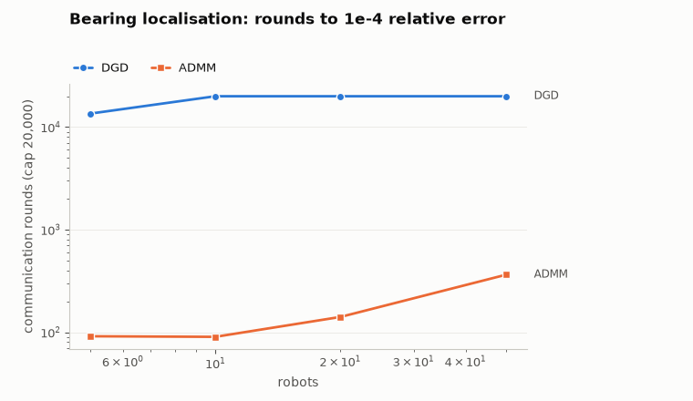

# Distributed optimisation benchmarks

Generated by `scripts/benchmark/coordination_report.py` from the `mrc_experiment_optimization_benchmark` experiment (configuration `configs/optimization/distributed_optimization.json`; seeds and parameters are also recorded in the result file). Machine: Windows AMD64, CPU only, Release build. Runtimes are wall-clock and indicative only.

Cooperative bearing-only target localisation: each robot holds one noisy bearing (0.03 rad), i.e. a rank-one least-squares term, and starts from its own position. Stopping criterion: every robot within 1e-4 (1 + ||x*||) of the centralised least-squares solution, at most 20,000 rounds. One round = one exchange of estimates with all neighbours (2 |E| messages).

| Method | Topology | Robots | Rounds | Converged | Final error [m] | Messages | Runtime [ms] |
|---|---|---|---|---|---|---|---|
| DGD | ring | 5 | 14,464 | 2/5 | 0.00117 | 144,638 | 17.228 |
| ADMM | ring | 5 | 63.4 | 5/5 | 0.000689 | 634 | 0.0731 |
| DGD | ring | 10 | 20,000 | 0/5 | 0.00377 | 400,000 | 47.085 |
| ADMM | ring | 10 | 76.2 | 5/5 | 0.000874 | 1,524 | 0.188 |
| DGD | ring | 20 | 20,000 | 0/5 | 0.0136 | 800,000 | 105.136 |
| ADMM | ring | 20 | 91 | 5/5 | 0.00126 | 3,640 | 0.411 |
| DGD | ring | 50 | 20,000 | 0/5 | 0.0524 | 2,000,000 | 213.206 |
| ADMM | ring | 50 | 278 | 5/5 | 0.0021 | 27,800 | 2.704 |
| DGD | random_geometric | 5 | 13,536 | 2/5 | 0.00127 | 217,392 | 16.586 |
| ADMM | random_geometric | 5 | 91.4 | 5/5 | 0.000625 | 1,421 | 0.171 |
| DGD | random_geometric | 10 | 20,000 | 0/5 | 0.00298 | 952,000 | 47.626 |
| ADMM | random_geometric | 10 | 90.2 | 5/5 | 0.000851 | 4,284 | 0.209 |
| DGD | random_geometric | 20 | 20,000 | 0/5 | 0.0108 | 2,240,000 | 110.705 |
| ADMM | random_geometric | 20 | 141 | 5/5 | 0.00121 | 15,887 | 0.644 |
| DGD | random_geometric | 50 | 20,000 | 0/5 | 0.0284 | 7,384,000 | 228.517 |
| ADMM | random_geometric | 50 | 363.4 | 5/5 | 0.00197 | 135,143 | 3.918 |

Decentralised ADMM reaches the optimum in tens to a few hundred rounds. Distributed gradient descent with a diminishing step converges sublinearly and does not reach the tolerance within the round budget; with a constant step it stalls in a neighbourhood of the optimum whose size shrinks with the step (verified in the unit tests).
